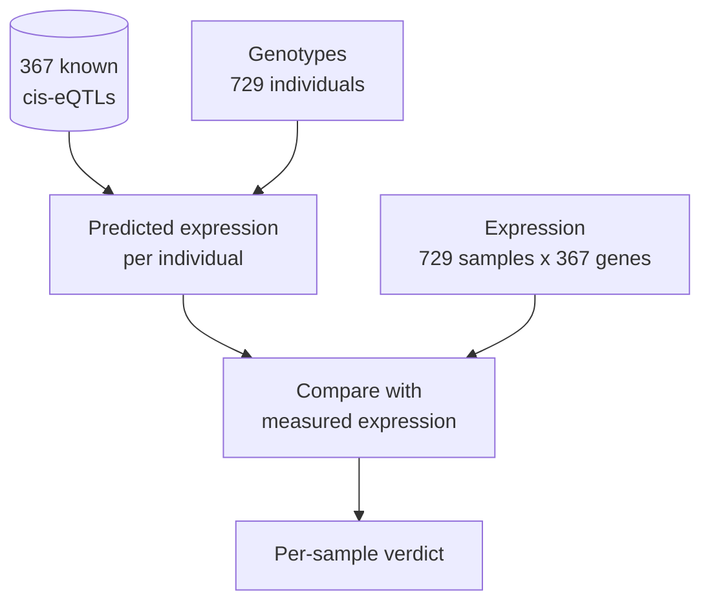

# Quickstart

This page takes you from a fresh installation to a first result in a few minutes. It runs the
quickest analysis, **sample identity matching**, on the example data that ships with the
repository. Every command is run from the repository root, and every number below comes from
an actual run with qpgen 0.2.0.

## 1. Check the installation

```bash
anqchor --version            # anqchor 0.1.0.dev0
anqchor qpgen check          # status: ok (pair-prs, match-prs-pheno, pair-assoc, rect-assoc available)
extern/qpgen/bin/qpgentools --version   # qpgentools 0.2.0 (git 5b811e2)
```

If `anqchor` is not found, prefix the commands with `uv run` or activate `.venv`. If
`qpgen check` fails, see [Installation](installation.md#3-build-qpgen).

## 2. The question

Every omics sample in an xQTL study carries a label that says which genotyped individual it
came from. Sample swaps, mislabelled tubes and contaminated libraries break that link, and a
broken link weakens every association you test later.

Identity matching checks each link with the genetics itself. Known cis-eQTL effects, applied
to an individual's genotypes, predict that individual's expression of each gene. Across
hundreds of genes the predicted profile of a person matches their own measured profile far
better than anyone else's. anqchor compares every expression sample against every genotyped
individual and reports whether the labelled individual is the best match.



## 3. The inputs

The example data in `examples/mage/data/` (32 MB) comes from the MAGE RNA-seq study of
1000 Genomes lymphoblastoid cell lines, restricted to chromosomes 21 and 22. The
[example data page](../use-cases/example-data.md) describes how it was built.
Identity matching uses four files.

**Genotypes**: a qpgen *pgen list* naming one PLINK2 file set per chromosome. Each set has a
`.pgen`, a `.psam` and an indexed pvar (`.pvar.idx.gz` + `.tbi`). Together: 729 individuals ×
256,645 variants with minor allele frequency ≥ 5%.

```console
$ cat examples/mage/data/geno/mage.pgen_list.tsv
21	1	1000000000	mage_chr21
22	1	1000000000	mage_chr22
$ head -3 examples/mage/data/geno/mage_chr21.psam
#IID
HG00096
HG00100
```

The columns of the pgen list are `CHROM BEG END PREFIX`. A relative prefix is found next to
the list file.

**Expression**: one row per sample, one column per gene (the *regenie* layout). 729 samples ×
367 genes.

```console
$ gzip -dc examples/mage/data/pheno/mage_expr.chr21_22.regenie.tsv.gz | head -3 | cut -f1-4
FID	IID	ENSG00000275993.3:SIK1B	ENSG00000278931.1:bP-2189O9.2
HG00096	HG00096	-0.238523	0.224454
HG00100	HG00100	-0.217436	-0.309645
```

**Covariates**: the same layout. Sex (`XX`/`XY`, a categorical covariate that qpgen encodes
itself; anqchor passes `--cat-cov-names sex`), 5 genotype principal components and 60 PEER
factors: 66 covariates. Identity matching removes their effect from the expression before
comparing.

```console
$ gzip -dc examples/mage/data/pheno/mage_covariates.regenie.tsv.gz | head -3 | cut -f1-8
FID	IID	sex	PC1	PC2	PC3	PC4	PC5
HG00096	HG00096	XY	-0.0216243	0.0487524	0.00362148	0.0446186	0.00187148
HG00100	HG00100	XX	-0.0215191	0.0503942	0.00281614	0.040869	0.000118772
```

**Known xQTLs (the reference)**: one row per gene–variant pair. 367 cis-eQTLs from GTEx
(EBV-transformed lymphocytes, the same cell type as MAGE, in donors who are not MAGE
individuals), one per gene: the gene's strongest (sentinel) variant. `variant` is
`CHROM:POS:REF:ALT` and `beta` is the effect of the `ALT` allele.

```console
$ gzip -dc examples/mage/data/reference/gtex_lcl_eqtl.chr21_22.tsv.gz | head -3
trait	variant	beta	se	pval
ENSG00000275993.3:SIK1B	21:6122794:C:T	-0.448959	0.0888711	8.054e-07
ENSG00000278931.1:bP-2189O9.2	21:9370164:G:A	0.484109	0.10423	5.31901e-06
```

Here the expression sample IDs equal the genotype IDs, so no sample map is needed. With
your own data, `--sample-map` gives a `geno_id pheno_id` table
(see [Inputs](../user-guide/inputs.md#sample-maps-match-only)).

## 4. Run the analysis

```bash
anqchor match run \
  --geno-list examples/mage/data/geno/mage.pgen_list.tsv \
  --pheno examples/mage/data/pheno/mage_expr.chr21_22.regenie.tsv.gz \
  --cov examples/mage/data/pheno/mage_covariates.regenie.tsv.gz \
  --pairs examples/mage/data/reference/gtex_lcl_eqtl.chr21_22.tsv.gz \
  --out results/match
```

```text
[anqchor] running prepare.genotypes
[anqchor] running prepare.reference.reference
[anqchor] running prepare.dataset.dataset
[anqchor] running prepare.mapping.dataset.reference
[anqchor] running prs.reference
[anqchor] running match.dataset.qpgen
[anqchor] running match.dataset.summarize
ran: prepare.genotypes, prepare.reference.reference, prepare.dataset.dataset, prepare.mapping.dataset.reference, prs.reference, match.dataset.qpgen, match.dataset.summarize
```

This takes about 7 seconds on a laptop. anqchor checks the inputs, computes a polygenic score
for every individual and gene (`qpgentools pair-prs`), scores every sample against every
individual (`qpgentools match-prs-pheno`) and writes summary tables. Without a configuration
file the dataset is called `dataset` and the reference `reference`; these names appear in
step and directory names.

`match run` writes no HTML. Render the report from the tables, which takes about a second and
runs no analysis:

```bash
anqchor match report --out results/match
# match report: results/match/report/match.html
```

`anqchor match all` with the same flags does both in one command. Run the same `match run`
command again and nothing is recomputed (`ran: nothing (all steps up to date)`).

## 5. The outputs

```text
results/match/
├── anqchor.resolved.yaml     every setting of this run (re-run it with --config)
├── run.json                  provenance: anqchor version, qpgen binary and commit, commands, timings
├── match/dataset/
│   ├── summary.json          verdict and counts
│   ├── samples.tsv           one row per expression sample
│   ├── swaps.tsv             samples that match another individual
│   ├── candidates.tsv        unlabelled samples with a clear match (rescue candidates)
│   ├── related.tsv           samples with several close matches (possible relatives)
│   └── weights.tsv           how much each gene contributes
├── report/match.html         the interactive report (after 'match report')
├── prepare/  prs/            prepared inputs and polygenic scores
└── logs/  steps/  Makefile   step logs and bookkeeping
```

Every file and column is described in [Output files](../reference/outputs.md#match).

## 6. Interpret the result

The verdict in `summary.json` (the report shows the same counts as tiles):

```text
727 of 729 mapped samples confirmed (14 only leniently); 2 unclear
```

| Status | Group | In the report | Samples | Meaning |
|---|---|---|---|---|
| `SELF_BEST` | `PASS` | Strict match | 713 | the labelled individual is the best match |
| `SELF_LENIENT` | `WARN` | Lenient match | 14 | the labelled individual is not the best match, but its Z-score is above 1.96 |
| `UNCLEAR` | `WARN` | Own ID too weak | 2 | the labelled individual is not the best match and scores at most 1.96, and no other individual is clearly better |

The two unclear samples, from `samples.tsv`:

| `pheno_id` | `z_self` | `rank_self` | `best_id` | `z_best` | `z_gap` |
|---|---|---|---|---|---|
| `NA11919` | 0.41 | 253 | `HG00237` | 3.60 | 0.32 |
| `NA12717` | 1.94 | 13 | `NA19404` | 2.71 | 0.03 |

The expression labelled `NA11919` does not match its own genotypes: rank 253 of 729, at the
level of an unrelated individual, while correctly labelled samples typically reach Z ≈ 5.5.
Its best candidate, `HG00237`, is only 0.32 ahead of the next, which is not a clear match
(the default asks for a lead of 2), so anqchor names no new ID. The label is probably wrong,
but the true source is unknown: someone not genotyped here, a mixture or a poor library.
For `NA12717` every candidate, its own included, is at background level: weak signal
rather than evidence of a wrong label.

In a real study you would now look at the lab records for `NA11919`, and leave it out of the
xQTL analysis until it is resolved.

`related.tsv` lists 8 samples that have a second individual close behind the best match:
usually relatives. They are informational, not errors, and the report does not show them.

## 7. What to try next

- Change the thresholds: `--z-threshold 2.5` (lenient match) or `--z-diff 3` (clear new best),
  then `match run` again. Only the matching steps re-run.
- Score correlated genes jointly with `--mahalanobis` (slower, matches better here:
  [Independent vs Mahalanobis scoring](../use-cases/identity-matching.md#mahalanobis)).
- Walk through the full identity use case: [Sample identity](../use-cases/identity-matching.md).
- Compare covariate choices by how many known cis-eQTLs replicate:
  [Comparing cis runs](../use-cases/cis-strategies.md).
- Evaluate a trans setup (replicated pairs, hotspots, inflation): [trans evaluation](../use-cases/trans-strategies.md).
- Use your own data: [Inputs](../user-guide/inputs.md), [Running](../user-guide/running.md).

## Common errors

| Message | Cause and fix |
|---|---|
| `error: give --config FILE, or the input flags (see --help)` | No input flags were given. Add `--geno-list` (or `--pfile`), `--pheno` and `--pairs`. |
| `Invalid value for '--pheno': File '...' does not exist.` | A path is wrong. Paths given as flags are relative to the current directory: run from the repository root. |
| `qpgentools not found (tried: ...)` (exit code 4) | qpgen is not built or not found. Run `anqchor qpgen build`, or pass `--qpgen PATH`. |
| `error: another anqchor command is running in ...` (exit code 2) | Two commands wrote to the same `--out` directory at once. Wait, or use another `--out`. |
| `error: run failed in step <name>; log: ...` (exit code 3) | A step failed. The last log lines are printed above the error; the full log is in `logs/<name>.log`. |
| `... is not an anqchor run directory (no anqchor.resolved.yaml)` | `match report --out` names a directory that `match run` has not written. |
