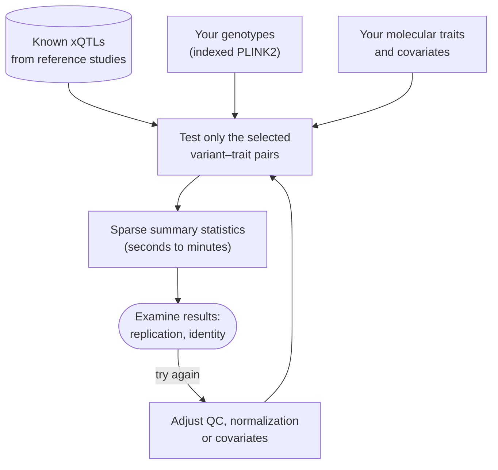
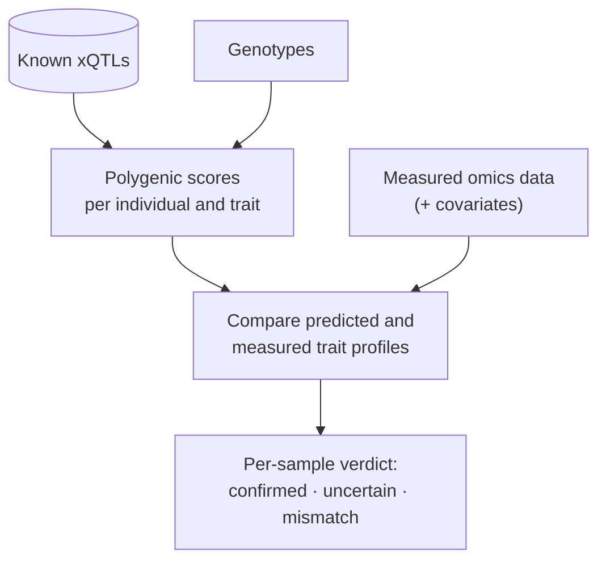
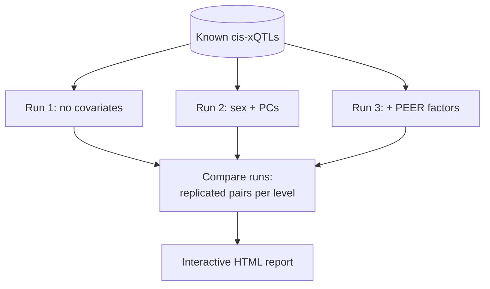

# anqchor

**Genetically anchored quality control for large-scale multi-omics xQTL analysis.**

anqchor helps you settle the quality-control and analysis choices of an xQTL study
*before* you commit to the full analysis. It checks that every omics sample belongs to the
genotyped individual it is labelled with. It also measures how well each candidate analysis
setup recovers associations that are already known.

## Why anqchor

A genome-wide xQTL analysis tests every variant against every molecular trait:
tens of millions of variants, thousands of traits, often more than ten thousand samples.
One such analysis is affordable. Repeating it is not. Yet the right choices are rarely known
in advance:

- which normalization of the molecular data to use;
- which covariates to adjust for (genotype PCs, PEER factors, batch);
- whether some omics samples are swapped, mislabelled or contaminated.

The usual way to decide is to run the full analysis, inspect the results, change the
settings and run it again, each round taking hours to days.

anqchor replaces this loop with a cheap one. Thousands of xQTLs are already known from
reference studies such as GTEx, eQTLGen and UK Biobank. These **known xQTLs are the
anchors**: anqchor tests only the variant–trait pairs they name, a sparse subset of the
full variant × trait matrix. Each evaluation then takes seconds to minutes, so you can try
many settings and compare them side by side.



## What anqchor does

anqchor applies the known xQTLs in two ways.

### Sample identity verification

Known xQTL effects applied to an individual's genotypes give a polygenic score for each
molecular trait: a genetic *prediction* of that trait. A single prediction is weak, but
across hundreds of traits the predicted profile of a person matches their own measured
profile far better than anyone else's. anqchor compares every omics sample against every
genotyped individual. It reports which samples match their labelled genotype, which match
someone else (a swap or a duplicated library), and which match nobody clearly.



### Analysis strategy evaluation

A good analysis setup should recover the associations that are already known. anqchor
re-tests the known cis pairs under one setup at a time: a choice of genotypes, phenotype
normalization and covariates. It counts how many replicate at several significance levels.
Runs with different setups are then compared in one report. For trans analysis, anqchor
tests every variant of the known pairs against every gene of the known pairs: it counts the
known cis and trans pairs that replicate, finds hotspots (regions with trans signals for many
genes) and checks that the cross-chromosome tests, which are almost all null, keep false
positives under control.



## Why it scales: indexed genotype files

Testing a sparse set of pairs is only fast if the genotypes of a few variants can be read
without scanning everything. A PLINK2 `.pgen` file allows random access to any variant by
its row number. But finding that row number normally means reading the whole `.pvar`
variant file, which holds hundreds of millions of lines in large studies.

anqchor and its engine [qpgen](https://github.com/hyunminkang/qpgen) solve this with an
**indexed pvar** (`.pvar.idx.gz`). It is the variant file compressed with `bgzip`, indexed
with `tabix`, and carrying each variant's row number in the `.pgen`. A lookup jumps
straight to the variant's position, reads its row number, and fetches its genotypes from
the `.pgen`. The cost then grows with the number of variants you *test*, not the number in
the file. One command builds the index from an existing PLINK2 dataset:

```bash
anqchor prepare index-pvar --pfile /path/to/prefix
```

## The analyses

Each analysis is run on its own, with command-line flags (a configuration file is optional).
The analysis step writes summary tables and the HTML report is a separate step, so you can
re-render or compare results without re-running anything.

| Analysis | Question | Commands |
|---|---|---|
| Identity matching | Does each omics sample come from the individual it is labelled with? | `anqchor match run`, `match report` (`match all` does both) |
| cis evaluation | How many known cis pairs replicate with these inputs and covariates? | `anqchor cis run` per setup, then `cis compare` across runs, `cis report` to re-render |
| trans evaluation | Do known cis and trans pairs replicate, are there hotspots, and is the trans analysis calibrated? | `anqchor trans run` per setup, then `trans compare` across runs, `trans report` to re-render |

## Example data

The repository ships a small example in `examples/mage/data/` (32 MB). It is taken from the
MAGE RNA-seq study of 1000 Genomes lymphoblastoid cell lines, restricted to chromosomes 21
and 22, with known cis-eQTLs from an independent study (GTEx) in the same cell type:

| Input | Content |
|---|---|
| Genotypes | 729 individuals × 256,645 variants (MAF ≥ 5%), indexed for qpgen |
| Expression | 729 samples × 367 genes, regenie layout |
| Covariates | sex, 5 genotype PCs, 60 PEER factors |
| Known cis-eQTLs | 367 gene–variant pairs: GTEx v10 eGenes of EBV-transformed lymphocytes with their sentinel variant |

On this example, identity matching confirms 727 of the 729 samples (14 of them only
leniently). Two are unclear; one of them, the expression labelled `NA11919`, clearly does not
match its own genotypes, but no other individual matches it clearly enough to be named. In
the cis evaluation, 178 of the 367 known pairs replicate at p < 10⁻⁵ without covariates,
231 with sex, PCs and 10 PEER factors, and 251 with all 66 covariates (sex, PCs and 60 PEER
factors).

## Where to go next

- [Installation](getting-started/installation.md): install anqchor and build qpgen.
- [Concepts](user-guide/concepts.md): the vocabulary used throughout.
- [Command line](reference/cli.md) and [output files](reference/outputs.md).

!!! note "qpgen version"
    anqchor needs qpgen 0.2.0 or later (`qpgentools --version`). Earlier builds did not
    center data in `pair-assoc` without covariates, read missing or text values as 0, and
    could misalign samples when the psam has family IDs. Categorical covariates
    (`--cat-cov-names`, used for text covariates such as `sex`) need the pinned submodule
    commit `5b811e2` or later. See
    [qpgen integration](reference/qpgen.md).
