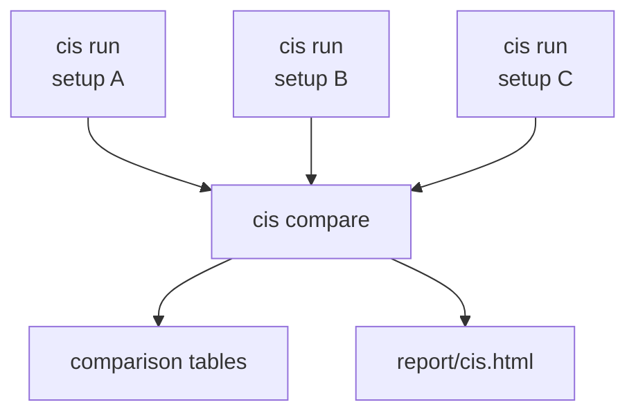

# cis: power by replication of known pairs

**Question:** how many known cis-xQTLs does an analysis setup recover in my data, and which
of several setups recovers the most?

A *setup* is one set of inputs: genotypes, phenotypes (and their normalization), covariates,
the phenotype transform (as given, or RINT with `--rint`) and the reference of known pairs. Each reference pair (trait, variant) is re-tested in the
study data. The number of pairs that replicate, at several strengths, is a cheap and direct
measure of cis-mapping power. You evaluate each setup in its own run and then compare the
runs, before any genome-wide scan.

For a worked example on the MAGE data, see
[cis evaluation: comparing analysis setups](../use-cases/cis-strategies.md).

## How it works



| Command | What it does | HTML |
|---|---|---|
| `anqchor cis run` | tests the reference pairs for **one** setup and writes the summary tables of that run | no |
| `anqchor cis compare RUN_DIR... --out DIR` | compares any finished runs, writes comparison tables | yes (`--no-report` to skip) |
| `anqchor cis report --out DIR` | re-renders `report/cis.html` of a comparison or of a single run from its tables (about 1 s, never runs qpgen) | yes |
| `anqchor cis all` | `cis run` and then `cis report` on the same run directory | yes |

Runs are independent: start them in parallel, each into its own `--out` directory.
Runs may differ in any input, not only in covariates. A run tests **one** phenotype
transform: the phenotypes as given (default), or with `--rint` a rank-based inverse normal
transform after covariate adjustment. To see what RINT changes, make a second run with
`--rint` and compare the two; phenotypes that are already inverse-normal transformed need no
RINT run.

A run is described by flags (a configuration file is optional):

```bash
anqchor cis run \
    --geno-list examples/mage/data/geno/mage.pgen_list.tsv \
    --pheno examples/mage/data/pheno/mage_expr.chr21_22.regenie.tsv.gz \
    --cov examples/mage/data/pheno/mage_covariates.regenie.tsv.gz \
    --cov-include sex,PC1-5,PEER1-10 \
    --pairs examples/mage/data/reference/gtex_lcl_eqtl.chr21_22.tsv.gz \
    --out results/cis/peer10
```

| Flag | Meaning |
|---|---|
| `--geno-list` or `--pfile` | genotypes: a qpgen pgen list, or one PLINK2 prefix with `.pgen/.psam/.pvar.idx.gz` |
| `--pheno`, `--pheno-format` | phenotype matrix (default format `regenie`) |
| `--cov`, `--cov-format` | covariate matrix. Omit `--cov` to run without covariates |
| `--cat-cov-names` | categorical covariates coded as numbers (e.g. a batch number); non-numeric columns such as `sex` are categorical automatically |
| `--cov-include` | use only these covariates of `--cov`: comma-separated names; ranges such as `PEER1-10` expand to `PEER1` … `PEER10`. Default: every covariate in `--cov` |
| `--pairs` | reference pairs: `trait variant beta se [pval]` |
| `--trait-annot` | trait loci (BED-like). Needed only to split the rect engine's controls by chromosome |
| `--trait-id-rule` | how reference trait IDs map onto phenotype columns (default `as_is`) |
| `--rint` | apply a rank-based inverse normal transform (RINT) to the phenotypes after covariate adjustment. Default: the phenotypes as given |
| `--assoc-engine` | `pair` (default, `pair-assoc`) or `rect` (`rect-assoc`) |

The same run can be written as a configuration file, for example
`examples/mage/cis.yaml`
(the all-covariate run): `anqchor cis run --config examples/mage/cis.yaml --out results/cis_config`.
See [Configuration](../user-guide/configuration.md) for every key.

## Steps of a run

With flags only, the dataset is called `dataset`, the reference `reference` and the run's
single strategy `default` (set `--dataset-name` / `--reference-name` to change the first
two). Step names below use `<ds>`, `<ref>` and `<s>` for them.

| Step | Kind | What it does |
|---|---|---|
| `prepare.genotypes` | Python | genotype samples, normalized pgen list |
| `prepare.reference.<ref>` | Python | reads the reference pairs, checks which variants are in the genotypes |
| `prepare.dataset.<ds>` | Python | normalizes phenotypes and covariates (categorical covariates such as `sex` keep their text levels `XX`/`XY`; qpgen encodes them) |
| `prepare.mapping.<ds>.<ref>` | Python | maps reference traits onto phenotype columns |
| `cis.<ds>.<s>.inputs` | Python | the run's covariate file (all of `--cov`, the `--cov-include` subset, or none) and `strategy.json` |
| `cis.<ds>.<s>.assoc` (pair engine) | qpgen | one `pair-assoc` run over the mapped pairs (`--skip-rint` unless `--rint`) |
| `cis.<ds>.<s>.rect.<t>` (rect engine) | qpgen | one `rect-assoc` run over the reference's present variants × mapped traits; `<t>` is `raw`, or `rint` with `--rint` |
| `cis.<ds>.summarize` | Python | replication levels, per-trait table, power curve, summary |
| `report.cis` | Python | `report/cis.html`; only with `cis all` or `cis report` |

The qpgen command of the all-covariate MAGE run (from the run's `Makefile`; paths are
relative to the run directory):

```bash
qpgentools pair-assoc --pgen-list prepare/genotypes/pgen_list.tsv \
    --pheno prepare/datasets/dataset/pheno.regenie.tsv.gz \
    --pairs prepare/datasets/dataset/ref.reference/pairs.tsv.gz \
    --out cis/dataset/strategies/default/pair_assoc.tsv.gz \
    --cov cis/dataset/strategies/default/cov.regenie.tsv.gz --cat-cov-names sex --skip-rint
```

With `--rint` the command has no `--skip-rint`, and the summary reads qpgen's `*_RINT`
columns. With `--assoc-engine rect` and `--rint`:

```bash
qpgentools rect-assoc --pgen-list prepare/genotypes/pgen_list.tsv \
    --pheno prepare/datasets/dataset/pheno.regenie.tsv.gz \
    --var-list prepare/datasets/dataset/ref.reference/variants.txt \
    --out cis/dataset/strategies/default/rect_assoc.rint.tsv.gz \
    --cov cis/dataset/strategies/default/cov.regenie.tsv.gz \
    --pheno-list prepare/datasets/dataset/ref.reference/traits.txt --cat-cov-names sex --rint-after-adj
```

Without covariates `--cov` is left out. `--cat-cov-names` lists the categorical covariates
among the run's covariates: non-numeric columns such as `sex` plus any named with
`--cat-cov-names` (for categories coded as numbers, e.g. a batch number). qpgen encodes each
as L − 1 indicator columns. `--cov-include sex,PC1-5` passes `--cat-cov-names sex`;
`--cov-include PC1-5,PEER1-10` passes none. anqchor needs qpgen 0.2.0 or later
([qpgen integration](../reference/qpgen.md)).

### Model and transform

- **Phenotypes as given** (default): the phenotype and the genotype are both residualized on
  the covariates (with an intercept; Frisch-Waugh-Lovell), then regressed on each other.
  `beta` is the partial effect of the genotype, as in `y ~ 1 + covariates + genotype`.
- **`--rint`**: the covariate-adjusted phenotype is rank-based inverse-normal transformed
  (Blom offsets, average ranks for ties) and tested the same way. `pair-assoc`'s `*_RINT`
  columns correspond to `rect-assoc --rint-after-adj`. RINT rescales the phenotype, so its
  effect sizes are not on the reference's scale; compare z-scores or −log10 p instead.
- **Degrees of freedom**: `df = N − 2 − k`, where N is the number of samples and k the rank of
  the covariate matrix; `N − 2` without covariates.

### Engines

`pair` (default) tests exactly the reference pairs. `rect` tests the whole rectangle of
reference variants × reference traits (346 × 367 = 126,982 cells on MAGE) and keeps the
non-reference cells as **local controls**: their λ_GC and p < 1e-5 counts appear in
`strategies.tsv` (`*_control*` columns), overall and for cross-chromosome cells (these need
`--trait-annot`). Same-chromosome control cells are in LD with neighbouring eQTLs, so they are
not a null; the cross-chromosome cells are much closer to one.

On MAGE both engines give identical replication counts at every level for the example runs
(with and without `--rint`), and identical per-pair statistics.

## Replication levels

Each tested pair gets one 0/1 flag per level. Every level requires **sign concordance**
(`sign(beta_ref) == sign(beta)`); alleles agree by construction because the reference
variant ID (`CHROM:POS:REF:ALT`) is the tested variant and `beta` is the effect of ALT.

| Level | Default rule | Cut-off on MAGE (367 pairs) |
|---|---|---|
| `sign` | sign concordance only | none |
| `nominal` | sign and p < 0.05 | −log10 p > 1.30 |
| `fdr` | sign and Benjamini-Hochberg q ≤ 0.05 over the run's tested pairs | data-dependent |
| `bonferroni` | sign and p < 0.05 / n_tested | 0.05/367 → −log10 p > 3.87 |
| `strict` | sign and p < 1e-5 | −log10 p > 5 |

The levels are configurable in a configuration file (`pipelines.cis.levels`; `null` switches
one off).

**Level order.** Levels are ranked by their actual −log10 p cut-off, not by name: with
367 pairs Bonferroni (p < 1.36e-4) is weaker than `strict`, but with tens of thousands of
pairs it is stronger. `summary.json` `level_order` records the order used.

**Status.** Every mapped pair has a `status`: `tested`, `variant_absent` (variant not in the
genotypes) or `not_tested` (present but no qpgen result or no finite statistic, for example a
variant with no variation among the phenotyped samples). The summary step **fails** when more
than `max_unresolved_fraction` (20%) of the mapped pairs are unresolved, because the result
would then say more about variant matching than about power. The error names absent
examples; a different genome build, `chr21` vs `21`, swapped REF/ALT or a different indel
representation are the usual causes.

**Recommendation** (comparison). The run with the most pairs at the strongest level (by
default `strict`), ties broken by the next weaker levels, then by order. `summary.json` and
the report state the reason in words.

**z-scores and effective sample size.** Every tested pair has a signed `z` = `beta / se`
and the reference's `z_ref` = `beta_ref / se_ref`; both refer to the same allele. For a
pair, E[z²] ≈ 1 + N·β²·Var(g)/σ²ₑ (the noncentrality), with σ²ₑ the residual variance, so
on the same pairs (mean z² − 1) is proportional to the effective sample size: removing
residual variance with covariates shrinks `se` and raises z² as more samples would. (The
normal quantile of the p-value would understate strong pairs, whose p-values come from a t
distribution.) `rel_neff` in `strategies.tsv` is (mean z² − 1) / (baseline mean z² − 1)
over the pairs tested in every run, the baseline being the first run. It is a ratio of
means, so pairs count in proportion to their z²: the strongest pairs dominate (in the MAGE
example the top 10 of 367 pairs carry about a third of Σz², and the median per-pair ratio
is larger than `rel_neff` for the stronger runs). The reference pairs are selected known
signals, not a random set of variants, so it is a relative diagnostic, not a sample
size. `cis compare` re-derives `z` from each run's `beta` and
`se`, so every compared run uses the same definition.

**π1** is Storey's 1 − π0 with a single λ = 0.5: approximate, only indicative for a few
hundred pairs.

## Outputs of a run

```text
results/cis/peer10/
├── cis/dataset/
│   ├── strategies.tsv          one row: counts per level, rint, mean z², ...
│   ├── pairs.long.tsv.gz       one row per reference pair (beta, z, −log10 p, reference values)
│   ├── traits.tsv              one row per trait
│   ├── power_curve.tsv         replicated count vs −log10 p threshold
│   ├── summary.json            everything above, levels, recommendation, warnings
│   └── strategies/default/     cov.regenie.tsv.gz, strategy.json, pair_assoc.tsv.gz
├── prepare/                    normalized inputs
├── logs/<step>.log             output of each step
├── steps/                      step stamps and run times (<step>.seconds)
├── anqchor.resolved.yaml       the complete settings of the run, flags included
└── run.json                    provenance: anqchor version, qpgen binary and commit, commands, host
```

A run writes no HTML; `anqchor cis report --out results/cis/peer10` renders
`report/cis.html` for it. Rows are labelled (`run` column) with the run directory name, here
`peer10`. Column definitions: [Output files](../reference/outputs.md#cis).
`pval_ref` is the reference's `pval` column (`NA` when the file has none; another column
name needs `columns: {pval: NAME}` in a configuration file).

**Reproducing a run.** `anqchor.resolved.yaml` holds every setting, including the flags:

```bash
anqchor cis run --config results/cis/peer10/anqchor.resolved.yaml --out results/cis/peer10_again
```

gives identical tables (labelled `peer10_again`).

## Outputs of a comparison

`anqchor cis compare RUN_DIR... --out DIR [--label L ...] [--no-report]` reads finished runs
(it never runs qpgen; about 1 s). Each run gets a **label**: the run directory name, or the
`--label` values in order (one per run). The comparison directory holds:

| File | Content |
|---|---|
| `runs.tsv` | one row per run: label, run directory, genotypes and sample count, phenotypes and sample counts, covariate file, `cov_include` (`all` when every covariate was used), `n_cov`, covariate columns, `rint`, reference, engine, mapped pairs |
| `strategies.tsv` | one row per run (`run` = `label` = the run label): the run's own counts (`n_tested`, `n_rep_<level>`, `frac_rep_<level>`, `median_log10p`, `mean_z2`, `beta_corr`, `pi1`, ...), plus `n_common_tested`, `n_rep_<level>_common`, `mean_z2_common` and `rel_neff` (effective sample size relative to the first run) |
| `pairs.long.tsv.gz` | the runs' long tables stacked (`run` = label), with levels re-derived using the first run's level settings |
| `traits.tsv` | one row per trait, `best_log10p:`/`level:`/`delta_log10p:<run>` (delta against the first run), `best_run` |
| `power_curve.tsv` | per run: replicated pairs at −log10 p thresholds 0, 0.5, 1, … |
| `summary.json` | as for a run, plus `runs`, `comparability` (`same_reference`, a hash of each run's reference, `rint` per run) and `recommended` |
| `compare.json` | manifest of the comparison (runs, labels, command); `cis report` uses it to recognise a comparison directory |
| `settings/<label>.anqchor.yaml` | the exact settings of each compared run (a copy of its `anqchor.resolved.yaml`) |
| `report/cis.html` | the report (unless `--no-report`) |

**Common pairs.** Runs can test different pairs (a different reference, or a genotype set
missing some variants). `n_common_tested` is the number of pairs (matched by reference trait
and variant) tested in **every** compared run, and `n_rep_<level>_common` counts replication
over those pairs only, with FDR and Bonferroni recomputed on them. When the runs tested the
same pairs, the `_common` columns equal the plain ones. Runs may differ in the phenotype
transform: each run's rows carry its own statistics, and `runs.tsv` records `rint`. anqchor warns when the runs used
different reference files or tested different pairs; then compare the `_common` columns.
The recommendation and the report's charts use each run's own counts.

## Reading the report

The same page shows one run or a comparison (title *Comparing N runs*); the first run of a
comparison is the baseline. From top to bottom:

1. **Replicated pairs by p-value threshold**: the power curve. Pairs replicated (same sign,
   p < 10^−t, as the levels) against t on a log(1 + t) axis labelled in −log10 p, one line
   per run; dotted lines at the nominal and strict cut-offs and at the number of tested
   pairs. Count or percentage.
2. **Signal strength**: for a comparison first the effective sample size relative to the
   baseline (`rel_neff`, a dot per run on a log axis around ×1, with a 95% paired bootstrap
   interval), then |z| or −log10 p per run as boxes (middle half, 5th–95th percentile,
   median) with the reference study as a hollow box, all over the pairs tested in every
   run.
3. **Significant hits**: per run (rows), the pairs of the same sign, at the nominal and at
   the strict cut-off, with percentages and bars. FDR and Bonferroni counts are in the run
   details.
4. **Agreement with the reference**: for one run at a time, effect size, z and −log10 p
   against the reference (each axis on its own scale; a dashed least-squares line through
   0 with its slope for effect size and z), and (comparison) z against the baseline run
   with the line y = x. Open diamonds mark pairs with the opposite sign to the reference
   (against the baseline: pairs where the two runs disagree in sign).
5. **All pairs**: −log10 p in the reference and in each run, with the number of runs of
   opposite sign; a run's value is red with a minus sign where its effect has the opposite
   sign (100 rows a page, sortable, searchable, header and pair column pinned).
6. **Run details** (collapsed): covariates, RINT, samples, FDR and Bonferroni counts and
   saved settings per run; the FDR and Bonferroni rules; local controls (rect engine);
   untested pairs; a link to `strategies.tsv` with every per-run number.

### Interpretation

- Compare the `strict` and `bonferroni` counts. `sign` and `nominal` saturate when the
  reference eQTLs are strong, so they show that the data are sound but cannot rank setups.
- A difference of a few pairs out of hundreds is within noise; prefer the simpler setup
  unless the power curves separate over a wide range of thresholds.
- More replications is not always better: a setup that ignores population structure inflates
  every statistic and also "replicates" more. Check calibration with the rect engine's
  cross-chromosome controls.
- RINT matters little for expression that is already normalized and more for skewed
  phenotypes (proteins, metabolites). Test it as a separate `--rint` run.
- A low `beta_corr` or many sign-discordant pairs with an otherwise good setup point to a
  trait-mapping problem or a reference from a different tissue or population.
- If the reference was discovered in the same samples with the same covariates, the setup
  that reproduces the discovery model is favoured by construction. Use an independent
  reference (for example GTEx for the same tissue, as in the MAGE example) for real
  decisions.

## Several strategies in one configuration file

A configuration file may still list several entries under `pipelines.cis.strategies`; they
are then evaluated in one run directory, and `cis compare` labels them `<label>:<strategy>`.
Separate runs are simpler and can differ in any input, so this page and the example use one
setup per run.
