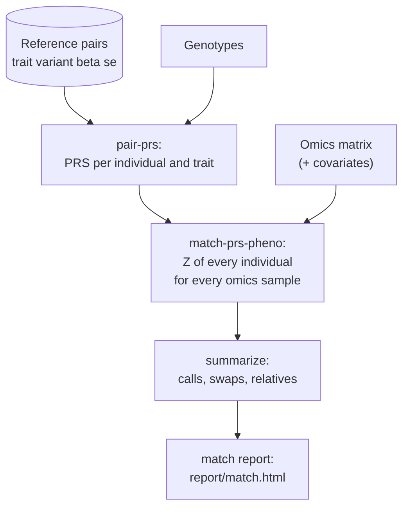

# match: sample identity

**Question:** does each omics sample come from the genotyped individual it is labelled with?

This page is the reference for the identity check: commands, steps, the qpgen calls,
the status rules and every output file. For a guided walk-through on the example data, see
the [identity matching use case](../use-cases/identity-matching.md).

## How it works

Known xQTL effects applied to the genotypes give every genotyped individual a predicted value
(a polygenic score, PRS) for each reference trait. qpgen's `match-prs-pheno` correlates each
omics sample's measured traits with every individual's PRS profile. It weights each trait by
how well its PRS predicts it, turns the correlations into Z-scores across all genotyped
individuals, and checks whether the labelled genotype is the best match.



Genotyped individuals without omics data are scored too. They make it possible to name the
true source of a mislabelled sample and to *rescue* omics samples that have no genotype
label.

## Commands

| Command | What it does |
|---|---|
| `anqchor match run` | prepares the inputs, computes the PRS, runs the matching and writes the summary tables. It writes no HTML. |
| `anqchor match report --out RUN_DIR` | renders `report/match.html` from the summary tables of a finished run, in about a second. It never runs qpgen. |
| `anqchor match all` | `match run` followed by `match report`. |

Inputs are given as flags; a configuration file (`--config`) is optional:

```bash
anqchor match run \
  --geno-list examples/mage/data/geno/mage.pgen_list.tsv \
  --pheno     examples/mage/data/pheno/mage_expr.chr21_22.regenie.tsv.gz \
  --cov       examples/mage/data/pheno/mage_covariates.regenie.tsv.gz \
  --pairs     examples/mage/data/reference/gtex_lcl_eqtl.chr21_22.tsv.gz \
  --out results/match
anqchor match report --out results/match
```

| Flag | Meaning | Default |
|---|---|---|
| `--geno-list` / `--pfile` | genotypes: a qpgen pgen list, or one PLINK2 prefix with `.pgen`, `.psam`, `.pvar.idx.gz` | required |
| `--pheno`, `--pheno-format` | omics matrix and its layout | required, `regenie` |
| `--cov`, `--cov-format` | covariates regressed out of the omics data before matching | none, `regenie` |
| `--cat-cov-names` | categorical covariates coded as numbers (e.g. a batch number); non-numeric columns such as `sex` are categorical automatically | none |
| `--pairs` | reference pairs (`trait variant beta se [pval]`) | required |
| `--sample-map` | `geno_id pheno_id` table when omics IDs differ from genotype IDs | identical IDs |
| `--trait-id-rule` | how omics trait IDs relate to reference trait IDs | `as_is` |
| `--use-cov` / `--no-use-cov` | adjust for `--cov` before matching | on |
| `--rint` / `--no-rint` | rank-based inverse normal transform after the adjustment | on |
| `--mahalanobis` / `--independent` | whiten correlated traits, or score them as independent | independent |
| `--lambda` | with `--mahalanobis`: `auto` or a value in [0, 1] | `auto` |
| `--z-threshold` | Z above which a non-best own genotype is a lenient match | 1.96 |
| `--z-diff` | Z gap that makes a leading genotype a clear match | 2.0 |
| `--prs-samples` | file of genotype IDs to use as candidates | all genotyped individuals |
| `--dataset-name`, `--reference-name` | names used in output paths with flag-only inputs | `dataset`, `reference` |
| `--threads` | threads for `match-prs-pheno` (changing it re-runs nothing) | 1 |

The configuration keys of the same settings are under `pipelines.match` and
`datasets.<name>` ([Configuration](../user-guide/configuration.md)).
`examples/mage/match.yaml` is a complete example. Every run directory also holds
`anqchor.resolved.yaml`, the full settings of the run including those given as flags, so

```bash
anqchor match run --config results/match/anqchor.resolved.yaml --out results/match_again
```

repeats a run exactly. `run.json` records the command line, the qpgen binary and the time
of each step.

## Steps

`<ref>` and `<ds>` are the reference and dataset names (`reference` and `dataset` with
flag-only inputs).

| Step | Kind | What it does | Run by |
|---|---|---|---|
| `prepare.genotypes` | Python | checks the genotype files; writes an absolute pgen list and the sample list | `run`, `all` |
| `prepare.reference.<ref>` | Python | normalises the reference pairs; checks which variants exist in the genotypes | `run`, `all` |
| `prepare.dataset.<ds>` | Python | converts the omics matrix and covariates to regenie layout (categorical covariates such as `sex` keep their text levels); reads the sample map | `run`, `all` |
| `prepare.mapping.<ds>.<ref>` | Python | maps reference traits onto omics traits | `run`, `all` |
| `prs.<ref>` | qpgen | `pair-prs` over all genotyped individuals (or `--prs-samples`) | `run`, `all` |
| `match.<ds>.qpgen` | Python + qpgen | restricts the trait and sample maps to what the PRS and the omics matrix contain, decides λ, runs `match-prs-pheno` | `run`, `all` |
| `match.<ds>.summarize` | Python | per-sample calls, swaps, rescue candidates, relatives, weights, `summary.json` | `run`, `all` |
| `report.match` | Python | `report/match.html` | `report`, `all` |

Re-running with the same settings runs nothing. Changing only `--z-threshold`, `--z-diff`,
`--rint`, `--use-cov`, `--mahalanobis` or `--lambda` re-runs `match.<ds>.qpgen` and
`match.<ds>.summarize`; the prepared inputs and the PRS are reused. After such a re-run,
run `anqchor match report` again: an existing `report/match.html` is not updated by
`match run`, which then prints `match report: ... is older than the results; update it with
'anqchor match report --out DIR'`.

### The qpgen calls

From the example run above (paths relative to the run directory):

```bash
qpgentools pair-prs --pgen-list prepare/genotypes/pgen_list.tsv \
    --pairs prepare/references/reference/pairs.tsv.gz --out prs/reference/prs
qpgentools match-prs-pheno --prs prs/reference/prs.prs.tsv.gz \
    --pheno prepare/datasets/dataset/pheno.regenie.tsv.gz --out match/dataset/qpgen \
    --cov prepare/datasets/dataset/cov.regenie.tsv.gz --cat-cov-names sex \
    --rint --z-threshold 1.96 --z-diff 2 --threads 1
```

`--cat-cov-names` lists the categorical covariates of the file: the non-numeric ones (here
`sex`, `XX`/`XY`) plus any named with anqchor's `--cat-cov-names` (config
`datasets.<ds>.cov_categorical`), for example a batch number. qpgen encodes each as L − 1
indicator columns ([covariates](../user-guide/inputs.md#covariates)). Without `--cov` (or with
`--no-use-cov`) both flags are left out.

Flags added when needed: `--sample` on `pair-prs` with `--prs-samples`; `--sample-tsv` with a
sample map; `--trait-tsv` when reference and omics trait IDs differ; `--mahalanobis` with
`--auto-lambda` or `--lambda X`; `--min-weight`; `--missing-str`. The `--out` prefix is a temporary directory inside `match/dataset/`
(shown as `match/dataset/qpgen` above). The exact command of a run
is in `match/<ds>/qpgen.params.json` (`argv`) and at the top of `logs/match.<ds>.qpgen.log`.

### Scoring: independence (default) or Mahalanobis

By default traits are scored as **independent**, the fast path. With `--mahalanobis`
(`mahalanobis: true`) qpgen whitens correlated traits:

- `--lambda auto` (the default) uses qpgen's `--auto-lambda` when at least
  `min_self_for_auto` (100) samples are mapped. With fewer, anqchor uses `--lambda 0.5` and
  says so in the log, `summary.json` `warnings` and the report.
- a number in [0, 1] is passed as `--lambda`. `λ = 1` is equivalent to independence.

`--lambda` without `--mahalanobis` is accepted and has no effect. On the example data,
auto-λ tunes to 0.58 and confirms 11 more samples strictly than independence scoring
([details](../use-cases/identity-matching.md#other-scoring-options)).

## Status rules { #status-rules }

anqchor ports qpgen's `MatchStatus` rules line by line, and the report ports them to
JavaScript; shared test vectors pin both. With `Z(1) ≥ … ≥ Z(5)` the top five Z-scores,
`t = z_threshold` and `d = z_diff`, checked in order:

1. `NO_OBS_TRAITS`: no observed trait with non-zero weight.
2. `SELF_BEST`: mapped, and the labelled genotype ranks first.
3. `SINGLE_NEW_BEST`: `Z(1) > Z(2) + d`.
4. `MULTI_NEW_BEST`: `Z(k) > Z(k+1) + d` for some k in 2..4.
5. `SELF_LENIENT`: mapped and `Z.self > t`.
6. `UNCLEAR` when mapped, `NO_SELF` otherwise.

Both comparisons are strict: a gap of exactly `z_diff` is not clear.

| Group | Statuses | Meaning |
|---|---|---|
| `PASS` | `SELF_BEST` | the labelled genotype is the best match |
| `WARN` | `SELF_LENIENT`, `UNCLEAR` | the labelled genotype is not the best, but no other genotype is clearly ahead |
| `FAIL` | `SINGLE_NEW_BEST`, `MULTI_NEW_BEST` of a mapped sample | one (or a few) other genotypes match clearly better |
| `NO_TEST` | `NO_SELF`, `NO_OBS_TRAITS`, every unmapped sample, `NOT_SCORED` | nothing to confirm or reject |

`NOT_SCORED` is anqchor's status for an omics sample missing from qpgen's output, for
example a sample without covariates.

A `NOT_SCORED` sample keeps its assigned genotype ID (from the sample map) in
`geno_id_assigned`, so it is counted as mapped, and `summary.json` `warnings` says how many
samples were not scored.

**Proposed relabel.** A mapped `FAIL` sample gets `proposed_geno_id` = its best genotype when
`Z(1) − Z(2) ≥ z_diff`, **unless** that genotype is the confirmed (`PASS`) match of another
omics sample. Relabelling would then map two samples to one genotype, so
`proposed_geno_id` stays empty and the note says "no relabel proposed: best genotype is the
confirmed match of another sample". The sample is still a mismatch.

**Rescue candidates.** An unmapped sample with `SINGLE_NEW_BEST` stays `NO_TEST` (there is no
label to confirm) and is listed in `candidates.tsv` with its best genotype, unless that
genotype is the confirmed match of another sample (the same rule as above; the report shows
such a sample as "ID already used").

**Two genotype IDs (duplicates).** A sample *matches two genotype IDs about equally* when
its top two candidates stand clear of the third by more than `z_diff` (qpgen's
`MULTI_NEW_BEST` test at k = 2), the second scores above `z_threshold`, and the second
scores at least 0.8 × the first. The two genotypes then most likely come from one person: a
genotype sample listed twice, or identical twins. Relatives do not qualify: a first-degree
relative scores about half the self Z (0.51–0.74 of it on the example data, for samples
whose own score is strong), a duplicated genotype 1.00 (0.90 with 2% of its calls
changed). A duplicate whose second score does not stand clear of the background
cannot be told from noise and is not flagged. The flag does not change `qpgen_status` or
`group`; such samples are listed in `duplicates.tsv` and named in the verdict. When the
assigned ID is one of the two (or no ID is assigned), the sample is not a mismatch: it gets
no `proposed_geno_id`, is not a rescue candidate, and is left out of the verdict's
mismatches, `n_fail`, `failing` and `swaps.tsv` (`n_fail_two_ids` counts such `FAIL`s).
Duplicates alone make the verdict a `warning`. With a small
`z_diff` (1 on the example data) a near-tie at background level can qualify too.

**Swaps.** A pair A, B where A's best genotype is B's label and B's best is A's is listed as
`reciprocal` when at least one side is a clear mismatch (`SINGLE_NEW_BEST`, a `FAIL`), and as
`reciprocal-weak` otherwise (for example two `SELF_LENIENT` samples whose own genotype is
second by a hair). Only `reciprocal` pairs count in `n_reciprocal_swaps`. Every other `FAIL`
sample is listed as `one-way`, with the sample (if any) that holds its best genotype as
partner.

**Possible relatives.** A sample is flagged when its top five start with a block of
k = 2..4 candidates, the best included, that stands out: the largest drop `Z(k) − Z(k+1)`
(k = 2..4) is at least 1.0 and `Z(k) ≥ z_threshold`. A first-degree relative's Z is roughly
half the self Z, and the best unrelated individuals reach Z ≈ 3 (on the example data the
median third-best Z is 2.7), so neither "within `z_diff` of the best" nor a Z threshold alone
describes a relative; the drop to the background does. The flag is informational and does
not change the group. A sample that matches two genotype IDs about equally is listed in
`duplicates.tsv` instead. The report does not show relatives.

## Outputs { #outputs }

Everything is under the run directory; per-dataset files under `match/<ds>/`. Full schemas
are in [Output files](../reference/outputs.md#match).

| File | Content |
|---|---|
| `match/<ds>/samples.tsv` | one row per omics sample: status, group, Z-scores, top five, proposal and note |
| `match/<ds>/swaps.tsv` | swaps: `kind` = `reciprocal`, `reciprocal-weak` (not counted) or `one-way` |
| `match/<ds>/candidates.tsv` | rescue candidates (unmapped samples with one clearly leading genotype) |
| `match/<ds>/duplicates.tsv` | samples that match two genotype IDs about equally |
| `match/<ds>/related.tsv` | samples whose top candidates start with a block of possible relatives |
| `match/<ds>/weights.tsv` | per-trait weight with the reference trait and a `weight_le0` flag |
| `match/<ds>/summary.json` | counts per status and group, verdict, failing samples, weight quantiles, parameters |
| `match/<ds>/qpgen.weights.tsv.gz`, `qpgen.match.assigned.tsv.gz`, `qpgen.match.all.tsv.gz` | qpgen's own outputs, unchanged |
| `match/<ds>/qpgen.params.json` | resolved parameters: argv, λ mode and value, trait and sample counts, warnings, log excerpt |
| `match/<ds>/trait_map.used.tsv` | the trait pairs used (traits with both a PRS and an omics column) |
| `prs/<ref>/prs.prs.tsv.gz`, `prs.se.tsv.gz` | PRS of every genotyped individual (regenie layout) |
| `report/match.html` | the report, written by `match report` or `match all` |
| `anqchor.resolved.yaml`, `run.json`, `logs/<step>.log` | settings, provenance, one log per step |

### `samples.tsv`

| Column | Meaning |
|---|---|
| `pheno_id` | omics sample ID |
| `geno_id_assigned` | labelled genotype (from the sample map, or the identical ID; empty when unmapped); kept for `NOT_SCORED` samples |
| `qpgen_status` | status as above (`NOT_SCORED` if qpgen did not score the sample) |
| `group` | `PASS`, `WARN`, `FAIL`, `NO_TEST` |
| `z_self`, `cor_self`, `rank_self` | Z-score, weighted correlation and rank of the labelled genotype |
| `n_traits` | traits observed for the sample |
| `best_id`, `z_best`, `cor_best` | best-matching genotype |
| `second_id`, `z_second`, `z_gap` | second-best genotype and `z_best − z_second` |
| `proposed_geno_id` | best genotype for a `FAIL` with a clear gap; empty otherwise, and empty when that genotype is another sample's confirmed match |
| `note` | who holds the best genotype, why no relabel is proposed, rescue candidate, two genotype IDs, several leading genotypes, possible relatives |
| `id_1`…`id_5`, `z_1`…`z_5` | the top five candidates |

### The other tables

| File | Columns |
|---|---|
| `swaps.tsv` | `kind pheno_id geno_id_assigned group best_id z_best z_self rank_self partner_pheno_id partner_geno_id_assigned partner_group partner_best_id` |
| `candidates.tsv` | `pheno_id candidate_geno_id z_best second_id z_second z_gap n_traits candidate_assigned_to` |
| `duplicates.tsv` | `pheno_id geno_id_assigned group geno_id_1 z_1 geno_id_2 z_2 z_3 assigned_in_pair` |
| `related.tsv` | `pheno_id geno_id_assigned group n_close close_ids close_z assigned_in_close` |
| `weights.tsv` | `trait ref_trait weight n_obs weight_le0` (weight = correlation of PRS and trait over mapped samples) |

### `summary.json`

The main keys: `verdict` (one sentence) and `verdict_status` (`good`, `warning`, or
`critical` when any sample fails); `status_counts` and `group_counts`; `failing` (each
`FAIL` with Z-scores, proposal and note, except samples that match two genotype IDs, one of
them their own); `n_fail` (the same samples) and `n_fail_two_ids`; `n_reciprocal_swaps`,
`n_rescue_candidates`, `n_duplicates`, `n_related`; `n_pheno`, `n_scored`, `n_not_scored`, `n_mapped`,
`n_unmapped`, `n_prs_samples`; `n_traits_used`,
`n_traits_weight_le0` and `weights` (quantiles); the parameters (`use_cov`, `rint`,
`mahalanobis`, `lambda_mode`, `lambda_used`, `z_threshold`, `z_diff`); `warnings`;
`qpgen_argv`; and `n_status_disagreements`, which is 0 unless the qpgen build applies
different status rules from anqchor's port.

## The report

`report/match.html` is a single file that works offline. Its title is "Sample identity
matching with anQChor". From top to bottom:

1. **Header**: counts (omics samples, genotypes, traits) and the scoring used; with
   independent scoring, a short tip to try `--mahalanobis`.
2. **Dashboard**: tiles (number first) for samples with an assigned ID, strict match to own
   ID (`SELF_BEST`), lenient match to own ID (`SELF_BEST` + `SELF_LENIENT`), matches another
   sample (`SINGLE_NEW_BEST`), matches two genotype IDs (every sample in **Duplicates**),
   matches several (`MULTI_NEW_BEST`), own ID too weak (`UNCLEAR`) and not scored
   (`NO_OBS_TRAITS`, `NOT_SCORED`); the two-IDs, several and not-scored tiles appear only
   when non-zero. A "No assigned ID" tile appears when some samples have no ID; its line
   splits them into new ID found, ID already used, two genotype IDs, no clear match and not
   scored. Tiles, cards, chart legend, table filters and table use the same result names.
   Clicking a tile filters the sample table.
3. **Sliders** for the lenient cutoff (`z_threshold`) and the clear lead (`z_diff`), each
   with a one-line hint (no info icons), and one line explaining the match score. Every
   count, card, chart point, duplicate and table row is reclassified in the browser with
   qpgen's rules. **Copy as config** gives the YAML lines that make the values permanent;
   the files in the run directory keep the values of the run.
4. **Samples to check**: one card per sample with an assigned ID that is not a strict match,
   per sample that matches two genotype IDs, and per sample without an assigned ID. When
   more than six samples have no ID, one card summarises them instead (counts per result,
   and how many with no clear match have a best genotype that no other sample uses). Two
   or more samples not scored share one card. An own-ID-too-weak card names the best
   genotype, its lead and the lead needed, and whether that genotype matches its own sample.
5. **How clearly each sample matches one genotype**: every scored sample, assigned or not,
   by its best match score (across) and its runner-up score (up). Below the dashed line the
   best genotype leads by more than the clear lead (grey shade, "one genotype clearly
   best"; a mismatch can lie there too); on the
   dotted diagonal the two tie. Samples without an assigned ID are hollow markers. The
   report calls qpgen's Z-score the "match score".
6. **Duplicates**: samples that match two genotype IDs about equally (see the rule above),
   with the two scores and the next one. A compact line says when there are none.
   Mismatches and relatives are not listed here.
7. **All samples**: searchable, sortable table (the page scrolls; the header stays on
   screen), 500 rows per page by default (100 on phones), with a TSV download of the current
   view. Columns (short one-line headers, fixed widths): sample, result, own score, own rank,
   best other (ID), its score, lead (own score minus the best other score; negative when
   another genotype fits better, red only for mismatches; for samples without an assigned
   ID, the best genotype's lead over the next, in italics) and suggested ID; an "Assigned ID"
   column appears when some assigned IDs differ from the sample IDs. On phones the table
   shows sample (with the best other genotype under it), result, own score and lead.
8. **Run details** (collapsed): settings, the trait-weight histogram, the report's result
   names with their `qpgen_status` codes, the qpgen command and a log excerpt.

## Interpretation

- `FAIL` with a `proposed_geno_id` and a `reciprocal` partner: a **sample swap**; relabel
  both. A `reciprocal-weak` pair is not evidence of a swap on its own.
- One-way `FAIL` whose best genotype belongs to a `PASS` sample: a **mismatch**; no relabel is
  proposed because that individual already has a matching omics sample. Exclude the sample
  or check the lab records.
- A sample in `duplicates.tsv`: its two leading genotypes are probably **one person under two
  genotype IDs** (a duplicated genotype sample or identical twins). When the own ID is one of
  the two, the omics label is fine: check the genotype set. qpgen calls it
  `MULTI_NEW_BEST` (or `SELF_BEST` when the own ID ranks first by a hair).
- One-way `FAIL` with a `proposed_geno_id`: the sample probably comes from that individual,
  who has no confirmed omics sample of their own; relabel after checking.
- Other `MULTI_NEW_BEST`: several leading genotypes, possibly a **mixed** sample or a block of
  close relatives.
- `WARN` (`SELF_LENIENT`): the own genotype is close to the best. With few informative traits
  this is noise; a larger reference separates better.
- Many `UNCLEAR` samples or low Z overall: too few or weak reference traits, a wrong trait
  map, or phenotypes in another orientation.

!!! note "After `match`"
    `cis` and `trans` require identical sample IDs in genotypes and phenotypes and do not
    read the match results. Rename or drop samples in your input files before running them.

## Example data

On the shipped MAGE chromosome 21/22 example (729 samples × 367 genes, 729 genotyped
individuals, known eQTLs from GTEx), with the defaults:

| Group | Count | Statuses |
|---|---|---|
| PASS | 713 | `SELF_BEST` |
| WARN | 16 | 14 `SELF_LENIENT`; 2 `UNCLEAR`: `NA11919` (own Z 0.41, rank 253; best `HG00237` at 3.60 leads the next by only 0.32) and `NA12717` (own Z 1.94, rank 13; every candidate at background level) |
| FAIL | 0 | |
| NO_TEST | 0 | |

All 367 traits are used, 14 with weight ≤ 0 (median 0.24, range −0.35 to 0.80), and 8
samples are flagged as possibly related. The
[use case](../use-cases/identity-matching.md) explains these results and how they change
with the thresholds and scoring options.
