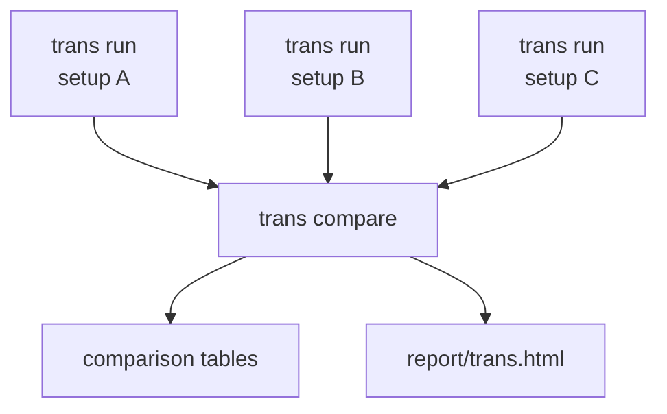

# trans: replication, hotspots and inflation

**Question:** if I run a trans-xQTL scan (variants against genes far away) with a given
setup, does it recover the known signals, does it report hotspots, and are its p-values
calibrated? And which of several setups does best?

A *setup* is one set of inputs: genotypes, phenotypes, covariates, the phenotype transform
(as given, or RINT with `--rint`) and the reference pairs. You evaluate each setup in its own
run, compare the runs, and read one report.

A worked example on the MAGE data, with every number explained:
[Use case: trans evaluation](../use-cases/trans-strategies.md).

## How it works



| Command | What it does | HTML |
|---|---|---|
| `anqchor trans run` | tests the rectangle for **one** setup and writes the summary tables of that run | no |
| `anqchor trans compare RUN_DIR... --out DIR` | compares any finished runs, writes comparison tables | yes (`--no-report` to skip) |
| `anqchor trans report --out DIR` | re-renders `report/trans.html` of a comparison or of a single run from its tables (about 1 s, never runs qpgen) | yes |
| `anqchor trans all` | `trans run` and then `trans report` on the same run directory (one run, no comparison) | yes |

Each run tests a **rectangle**: every variant of the reference pairs against every gene of
the reference pairs, with `qpgentools rect-assoc`. Each test is a *cell* of the rectangle.
From the cells, a run reports three things:

1. **Replicated reference pairs**, cis and trans separately: do the known pairs come back
   with the same sign and a small p-value?
2. **Hotspots**: genomic bins (1 Mb by default) whose variants seem to affect many genes far
   away. A few real hotspots exist; many hotspots usually mean a confounder.
3. **Inflation**: the cells whose variant and gene are on different chromosomes should be
   almost all null. λ_GC, observed vs expected counts and a QQ plot show whether they are.

## Evaluate several setups

Run one `trans run` per setup, each into its own directory, then compare the runs. The
commands below use the example data shipped in the repository and run from its root:

```bash
D=examples/mage/data
IN=(--geno-list $D/geno/mage.pgen_list.tsv
    --pheno $D/pheno/mage_expr.chr21_22.regenie.tsv.gz
    --trait-annot $D/pheno/mage_genes.chr21_22.bed
    --pairs $D/reference/gtex_lcl_eqtl.chr21_22.tsv.gz)
COV=(--cov $D/pheno/mage_covariates.regenie.tsv.gz)

anqchor trans run "${IN[@]}"                                              --out results/trans/nocov
anqchor trans run "${IN[@]}" "${COV[@]}" --cov-include sex,PC1-5          --out results/trans/basic
anqchor trans run "${IN[@]}" "${COV[@]}" --cov-include sex,PC1-5,PEER1-10 --out results/trans/peer10
anqchor trans run "${IN[@]}" "${COV[@]}"                                  --out results/trans/peer60
anqchor trans run "${IN[@]}" "${COV[@]}" --rint                           --out results/trans/peer60_rint

anqchor trans compare results/trans/nocov results/trans/basic results/trans/peer10 \
    results/trans/peer60 results/trans/peer60_rint --out results/trans/compare
```

(`IN` and `COV` are shell arrays, so the commands work in both bash and zsh.) Each run takes
about 8 s on the example data (346 variants × 367 genes); the runs are independent and can
run at the same time. `trans compare` takes about 1 s, runs no association test and writes
`results/trans/compare/report/trans.html`. To re-render that page later (for example after
updating anqchor), without running anything else:

```bash
anqchor trans report --out results/trans/compare
```

`trans report --out RUN_DIR` renders the page of a single run in the same way.

| Flag | Meaning |
|---|---|
| `--geno-list` or `--pfile` | genotypes: a qpgen pgen list, or one PLINK2 prefix |
| `--pheno`, `--pheno-format` | phenotype matrix (default format `regenie`) |
| `--trait-annot` | gene loci (BED-like `chrom start end id`, start = TSS); **needed** to tell cis from trans |
| `--trait-id-rule` | how reference trait IDs map onto phenotype columns (default `as_is`; e.g. `strip_version` for versioned ENSG IDs) |
| `--pairs` | reference pairs `trait variant beta se [pval]`: their variants and genes make the rectangle, and they are the pairs to replicate |
| `--cov`, `--cov-format` | covariates; omit `--cov` for none |
| `--cov-include` | only these covariates of `--cov` (comma-separated; `PEER1-10` expands) |
| `--cat-cov-names` | categorical covariates coded as numbers (non-numeric columns such as `sex` are categorical automatically) |
| `--rint` | RINT of the phenotypes after covariate adjustment (`rect-assoc --rint-after-adj`). Default: the phenotypes as given |
| `--cis-window-bp` | cis window around the gene start (default 1,000,000) |
| `--hotspot-bin-bp` | bin width for hotspots (default 1,000,000) |
| `--hotspot-min-traits` | genes a bin needs to be a hotspot (default 5; the report can change it) |
| `--variants`, `--traits` | other variants (a `CHROM:POS:REF:ALT` list) or genes (`all`, or a file) for the rectangle |
| `--min-maf` | minimum minor allele frequency (default 0.01) |
| `--dataset-name`, `--reference-name` | names of the dataset and the reference in the run's files (default `dataset`, `reference`) |
| `-j`, `--jobs` | steps run at the same time (default 1) |

`trans compare` takes the run directories and:

| Flag | Meaning |
|---|---|
| `-o`, `--out` (required) | the comparison directory to write |
| `--label` | a label per run, in order (repeat once per run). Default: the run directory names, or `<parent>_<name>` when two names are the same |
| `--report/--no-report` | also write `report/trans.html` (default) or the tables only |
| `--plotlyjs` | `embed` (default, works offline) or `cdn` |

A run tests **one** phenotype transform. Phenotypes are often already inverse-normal
transformed; to see what RINT changes, make a second run with `--rint` and compare.

With flags only, the dataset is called `dataset`, the reference `reference` and the run's
covariate set `default`, so a run's tables are under `trans/dataset/`. A run can also be
written as a configuration file (`examples/mage/trans.yaml`, the all-covariate run), which is
also how to set what has no flag (`levels`, `trait_chroms`, `known_pairs`, `max_sig_rows`);
see [Configuration](../user-guide/configuration.md#pipelinestrans).

Every run directory holds `anqchor.resolved.yaml` (all settings, flags included) and
`run.json` (provenance). `--config RUN/anqchor.resolved.yaml --out NEW` reproduces a run; a
comparison keeps a copy of each run's settings in `settings/<label>.anqchor.yaml`. Running
the same `trans run` again does nothing; a changed setting re-runs only what depends on it:
`--hotspot-min-traits 2` or `--hotspot-bin-bp 500000` re-runs only the summary (about 2 s).
`--out` of `trans compare` must be a new directory or an earlier trans comparison (which is
replaced); a run directory or a cis comparison is refused.

## Definitions

**cis and trans.** A (variant, gene) pair is **cis** when the variant is on the gene's
chromosome within `--cis-window-bp` (1 Mb) of the gene start (TSS); every other pair whose
gene has a locus is **trans**: on another chromosome (**cross-chromosome**), or on the same
chromosome farther than the window. Genes without a locus are counted apart. The same rule
classifies the cells of the rectangle and the reference pairs.

**Replication.** A tested reference pair replicates at a level when its effect has the
reference's sign and, for the p-value levels, p < 0.05 or p < 1e-5 (the levels of the cis
report). Pairs whose variant is not in the genotypes, or that have no result, are counted
as not tested.

**Hotspots.** Trans cells only. Variants are grouped into bins of `--hotspot-bin-bp` by
position (bin = ⌊position / bin width⌋ on each chromosome). A bin's count at a p-value
threshold is the number of **distinct genes** with a trans cell below the threshold from any
variant of the bin, not counting genes **in cis with the bin** (gene start within the cis
window of any tested variant of the bin), so the tail of a cis signal is not counted as a
trans signal. A **hotspot** is a bin with at least k genes. The summary holds the hotspot
count for every threshold among p < 1e-4, 1e-5, 1e-6, 5e-8, 1e-8 and 1e-10, the configured
`levels` (`levels.nominal` 1e-5, optional `levels.strict`) and **Bonferroni** (0.05 / trans
cells tested), and every k among 1, 2, 3, 5, 10, 20 and `--hotspot-min-traits`. The report
opens on p < `levels.nominal` (1e-5) and k = `--hotspot-min-traits`. With k = 1 the count is the number of bins with
any trans signal.

**Inflation.** The cross-chromosome cells. When the reference has trans pairs, the cells of
every variant within the cis window of a reference trans pair's variant, and every cell of
that pair's gene, are left out, so that known trans signals do not count as inflation; the
summary says how many cells were left out. Then:

- **λ_GC** = median χ²(1) statistic of the cells / 0.4549 (the χ²(1) median); 1 when
  calibrated. anqchor warns above 1.1 and below 1/1.1.
- **Observed vs expected** cells at p < 1e-3 and p < 1e-5 (expected = cells × p).
- **QQ plot**: observed against expected −log10 p, with the 95% range of each order
  statistic under no association (rank r of n uniform p-values follows Beta(r, n − r + 1)).

All of these are computed exactly from qpgen's output in one streaming pass.

## Steps of a run

With flags only, the dataset is called `dataset` and the run's single strategy `default`
(`--dataset-name` changes the first). Step names below use `<ds>` and `<s>` for them.

| Step | What it does |
|---|---|
| `prepare.*` | input preparation (the trait mapping is skipped for a variants-only reference) |
| `trans.<ds>.lists` | `variants.txt` (sorted, de-duplicated, genotype chromosome style), `traits.txt` (after `trait_chroms`), `lists.json` |
| `trans.<ds>.<s>.inputs` | the run's covariates and `strategy.json` |
| `trans.<ds>.<s>.rect.<t>` | `qpgentools rect-assoc`; `<t>` is `raw`, or `rint` with `--rint` |
| `trans.<ds>.summarize` | streams the rectangle: replication by class, hotspot bins and grid, inflation |
| `report.trans` | `report/trans.html`; only with `trans all` or `trans report` |

The qpgen command of the `peer10` run (from the run's `Makefile`):

```bash
qpgentools rect-assoc --pgen-list prepare/genotypes/pgen_list.tsv \
    --pheno prepare/datasets/dataset/pheno.regenie.tsv.gz --var-list trans/dataset/variants.txt \
    --out trans/dataset/strategies/default/rect_assoc.raw.tsv.gz \
    --cov trans/dataset/strategies/default/cov.regenie.tsv.gz --pheno-list trans/dataset/traits.txt \
    --cat-cov-names sex --min-maf 0.01 --min-mac 1 --max-chunk-vars 100
```

`--pheno-list` is omitted only with `traits: all` and `trait_chroms: all`; `--rint` adds
`--rint-after-adj`. `--cat-cov-names` lists the categorical covariates among the run's
covariates; it is left out without covariates or when none is categorical.

**Memory.** The summarizer streams the wide matrix in row chunks and keeps the −log10 p of
the cross-chromosome cells used for inflation as float32 (4 bytes per cell, plus a sorted
copy), per-variant counts, and the cells below the loosest hotspot threshold with their
effects.

## The rectangle

| Flag (config key) | Value | Effect |
|---|---|---|
| `--variants` (`variants`) | `reference` (default) | the reference's variants present in the genotypes |
| | file | one `CHROM:POS:REF:ALT` per line |
| `--traits` (`traits`) | `reference` (default) | the genes of the reference pairs |
| | `all` | every gene of the phenotype file |
| | file | gene IDs in the first column |
| config only (`trait_chroms`) | `genotyped` (default) | keep genes whose locus is on a genotyped chromosome |
| | `all` | no restriction (genes without a locus are kept too) |
| | list | e.g. `[21, 22]`, either chromosome style |

With a pair file that holds cis and trans eQTLs, the rectangle contains both kinds of
signal. With a cis-only pair file (as in the example), every reference pair is cis and the
trans side of the report says so.

## Outputs of a run

Under each run directory (column schemas: [Output files](../reference/outputs.md#trans)):

| File | Content |
|---|---|
| `trans/<ds>/summary.json` | the run, cell counts per class, replication by class, the hotspot grid, inflation, definitions, warnings |
| `trans/<ds>/reference_pairs.tsv` | every reference pair: class, status, effect, z, −log10 p, replication flags |
| `trans/<ds>/hotspots.tsv` | one row per bin with a tested variant: genes with a trans signal at each grid threshold, strongest cell |
| `trans/<ds>/hotspot_genes.tsv` | one row per bin and gene with a trans signal at the loosest grid threshold |
| `trans/<ds>/qq.tsv` | QQ quantiles of the cross-chromosome cells with the 95% band |
| `trans/<ds>/variants.tsv` | per variant: cells by class, trans signals, strongest trans and cis gene, left out of inflation or not |
| `trans/<ds>/pairs.sig.tsv.gz` | every cell with p < `levels.nominal` (1e-5), any class (at most `max_sig_rows`) |
| `trans/<ds>/variants.txt`, `traits.txt`, `lists.json` | the rectangle |
| `trans/<ds>/strategies/default/rect_assoc.{raw,rint}.tsv.gz` | qpgen output |
| `report/trans.html` | the page of this run alone (`trans all` / `trans report`) |
| `anqchor.resolved.yaml`, `run.json` | settings and provenance |

Rows are labelled (`run` column) with the run directory name.

## Outputs of a comparison

`anqchor trans compare RUN_DIR... --out DIR` reads finished runs (never qpgen). Each run gets
a **label**: the run directory name (`<parent>_<name>` when two are the same), or the `--label`
values in order. The comparison
directory holds ([column schemas](../reference/outputs.md#trans-compare)):

| File | Content |
|---|---|
| `runs.tsv` | one row per run: the inputs (genotypes, phenotypes, covariates, `rint`, reference), the rectangle and its cells, replicated reference pairs per class (`cis_*`, `trans_*`, and `*_common` over the pairs tested in every run), λ_GC, observed and expected counts, the hotspot count at the run's opening threshold and minimum (`n_hotspots`) and at the first run's (`n_hotspots_shared`, the same setting for every run) |
| `hotspot_grid.tsv` | hotspot counts per run, threshold and minimum genes |
| `hotspots.tsv`, `hotspot_genes.tsv`, `qq.tsv`, `reference_pairs.tsv` | the runs' tables stacked, with a `run` column |
| `summary.json` | the runs, the comparability checks, each run's summary and the warnings |
| `compare.json` | manifest (runs, labels, command); `trans report` uses it to recognise a comparison directory |
| `settings/<label>.anqchor.yaml` | the exact settings of each compared run |
| `report/trans.html` | the report (unless `--no-report`) |

**Comparability.** λ_GC, the observed counts and the hotspots are statistics of each run's
whole rectangle, so they compare directly only when the runs tested the same cells. anqchor
checks that the runs used the same genotype samples, phenotype samples, reference,
rectangle, cell counts, cis window, bin width and opening hotspot setting, and prints a
warning for each difference (for example "the runs tested different variant–gene tests
(…)"). Reference pairs are matched across runs by gene and variant; the `*_common` columns
count only the pairs tested in every run, and the report uses them when the runs tested
different pairs and share at least one.

## Reading the report

Title *Comparing N runs: trans-QTL evaluation with anQChor* (a single run: *trans-QTL
evaluation with anQChor*). Under it, one line with the number of runs, the rectangle, the
cross-chromosome cells, the samples and the reference file, then any warning. Runs keep one
color everywhere on the page. Then:

1. **Replicated reference pairs.** Two blocks, cis and trans; in each, one row per run with
   the pairs of the same sign, with p < 0.05 and with p < 1e-5, as counts, percentages of
   the tested pairs and bars (only the pairs tested in every run when the runs tested
   different pairs). "No trans pairs in the reference" when there are none.
2. **Hotspots.** Two rows of buttons choose the p-value threshold and the minimum genes per
   bin; the choice applies to every run. One row per run gives its number of hotspots and a
   bar for the share of bins that are hotspots. Below, for one run at a time (buttons, or a
   list with more than five runs or long labels; clicking a run's row also selects it): the
   genes with a trans signal per bin along the genome (hotspots in the run's color, the
   minimum dotted; hover a bar for its genes), the grid of hotspot counts over every
   threshold and minimum (click a cell to apply it to every run), and the top 10 hotspot
   bins with their genes ("Show all" for the rest).
3. **Inflation.** λ_GC per run (a dot per run, dotted line at 1), the QQ plot with one line
   per run over the grey 95% band (**Zoom**, the default, cuts the y axis at 1.5 times the
   band and names the runs above it; **Full** shows everything), and observed vs expected
   counts at p < 1e-3 and p < 1e-5 per run, with the ratio when at least 5 are expected or
   10 observed (red when it is more than twice the expected).
4. **Run details** (collapsed): per run the covariates, rank normalization, samples, rectangle, tests,
   Bonferroni threshold, bin width and a link to its saved settings; the definitions; every
   reference pair with −log10 p per run (negative: opposite sign; sorted by the first run);
   links to the tables.

The page of a single run shows the same three items for that run: cis and trans as rows,
the number of hotspots in large type, and the QQ plot with λ_GC and the observed counts
beside it.

### Interpretation

- **Calibrate first.** λ_GC near 1 and QQ lines inside the band mean calibrated tests. Well
  above 1 means missing covariates, population structure or batch effects: every
  significant trans cell of that run is then suspect, and hotspots appear everywhere.
- **Hotspots that disappear with covariates** were artefacts. Hotspots that remain with good
  covariates and recur across thresholds are worth a look; if many bins hit the same few
  genes, suspect a shared confounder before biology.
- **Strong trans hits that survive good covariates** are often paralogs or duplicated
  regions (reads or variant calls mapped to the wrong copy). Check the gene names.
- **cis replication** says the setup recovers known local signals; **trans replication**
  needs a reference with trans pairs and is usually much lower, because trans effects are
  small.
- **Choose** the run that keeps λ_GC near 1, has no hotspots it cannot explain, and
  replicates the most pairs at p < 1e-5.
- The more cells the rectangle has, the stricter the threshold has to be: read the hotspot
  grid at Bonferroni as well as at the fixed thresholds.

## Example results

On the example data (346 GTEx variants × 367 genes on chr21/22; 126,982 cells: 6,186 cis,
53,508 cross-chromosome, 67,288 same chromosome beyond 1 Mb). The GTEx reference has only cis
pairs, so nothing is left out of the inflation cells. Details in the
[use case](../use-cases/trans-strategies.md).

| Run | covariates | cis pairs p < 1e-5 (of 367) | λ_GC | p < 1e-5 observed (expected 0.5) | hotspots p < 1e-5, ≥ 5 genes |
|---|---|---|---|---|---|
| nocov | none | 178 | 1.74 | 445 | 37 |
| basic | sex, PC1-5 | 162 | 1.02 | 1 | 0 |
| peer10 | + PEER1-10 | 231 | 1.00 | 1 | 0 |
| peer60 | all 66 | 251 | 1.00 | 0 | 0 |
| peer60_rint | all 66, `--rint` | 251 | 1.00 | 0 | 0 |
