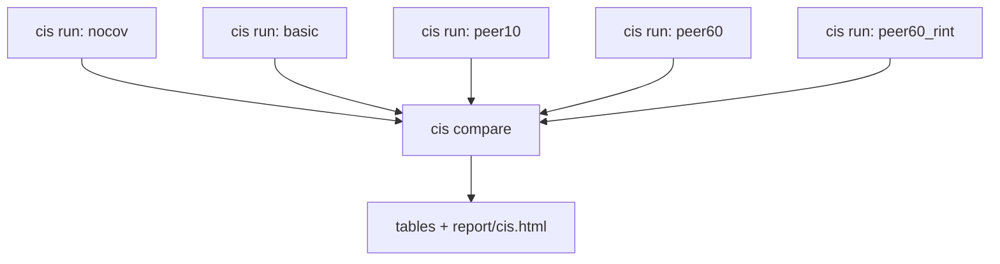

# cis evaluation: comparing analysis setups

**Question:** *which analysis setup (covariates, phenotype normalization, genotypes) gives
the most power to detect known cis-eQTLs in my data?*

Before a genome-wide cis-eQTL scan you have to choose how to model the expression: with no
covariates, with sex and genotype PCs, or with some number of hidden factors (PEER factors,
PCs of the expression matrix). The choice can change the number of eQTLs you find by a
factor of two. anqchor answers the question cheaply. Each `anqchor cis run` re-tests a list
of **known** cis-eQTL pairs (gene, variant) for one setup and counts how many come back
significant. `anqchor cis compare` then puts several runs side by side.

This page runs the whole comparison on the MAGE example data that ships with the
repository: 729 lymphoblastoid cell lines, four covariate setups with the expression as
given, and the all-covariate setup once more with a rank-based inverse normal transform
(RINT, `--rint`). The known pairs come from an independent study, GTEx, in the same cell
type. The five runs take about 7 seconds together.

!!! tip "Prerequisites"
    anqchor is installed and qpgen 0.2.0 or later is built
    ([Installation](../getting-started/installation.md)). All commands below are run from
    the repository root. Results go to `results/`, which git ignores.



## Why replication of known pairs measures power

A reference eQTL pair is a (gene, variant) association that another study, or an earlier
analysis, found with confidence. If the variant really affects the gene's expression, a
better analysis of your data gives a smaller p-value for that pair. Counting how many known
pairs reach a given significance level therefore ranks setups by power, using hundreds of
true positives at once:

- it is **cheap**: only the reference pairs are tested (367 regressions per run here), not
  every variant against every gene;
- it is **direct**: the count is the quantity you care about (how many real eQTLs you can
  detect), not a proxy such as the variance explained by the covariates;
- it is **comparable**: every run tests the same pairs, and the comparison counts pairs
  tested in every run separately when they differ.

What it does **not** measure is false positives. A setup that inflates every test statistic
(for example by ignoring population structure) also "replicates" more pairs. Check
calibration with the [rect engine's local controls](#the-rect-engine-and-local-controls)
before you trust a setup that wins without covariates.

## Inputs

The example data lives in `examples/mage/data/` (32 MB), cut down from the MAGE study by
`examples/mage/make_compact_data.sh`: chromosomes 21 and 22, the 729 individuals with
expression data, and the genes of the reference eQTLs. The reference eQTLs are from GTEx
([example data](example-data.md#reference-pairs)).

| File | What it is | Flag |
|---|---|---|
| `geno/mage.pgen_list.tsv` + `geno/mage_chr21.*`, `geno/mage_chr22.*` | genotypes, PLINK2: 729 individuals × 256,645 variants with MAF ≥ 5% | `--geno-list` |
| `pheno/mage_expr.chr21_22.regenie.tsv.gz` | expression, 729 samples × 367 genes | `--pheno` |
| `pheno/mage_covariates.regenie.tsv.gz` | covariates: sex, PC1-5, PEER1-60 (66 columns) | `--cov` |
| `reference/gtex_lcl_eqtl.chr21_22.tsv.gz` | 367 known cis-eQTL pairs from GTEx (the reference) | `--pairs` |
| `pheno/mage_genes.chr21_22.bed` | TSS position of each gene | `--trait-annot` (rect engine only) |

### Genotypes

A **pgen list** tells qpgen which PLINK2 file set covers which chromosome region:
`CHROM BEG END PREFIX`, no header. Relative prefixes are resolved from the list's directory.

```text title="examples/mage/data/geno/mage.pgen_list.tsv"
21	1	1000000000	mage_chr21
22	1	1000000000	mage_chr22
```

Each prefix has a `.pgen` (genotypes), a `.psam` (sample IDs) and an indexed variant file
`.pvar.idx.gz` + `.pvar.idx.gz.tbi` (made with `anqchor prepare index-pvar`; see
[Inputs](../user-guide/inputs.md#genotypes)). Variant IDs are `CHROM:POS:REF:ALT`, which is
how the reference names its variants. There are 127,563 variants on chr21 and 129,082 on
chr22.

```text title="mage_chr21.psam (first lines)"
#IID
HG00096
HG00100
```

```text title="mage_chr21.pvar.idx.gz (first lines)"
#CHROM  POS      ID               REF  ALT  QUAL  FILTER  INFO  INDEX
21      5031747  21:5031747:G:GA  G    GA   .     .       .     1
21      5031747  21:5031748:GA:G  GA   G    .     .       .     2
```

### Expression

regenie layout: one row per sample, `FID IID`, then one column per gene. Sample IDs are the
genotype IDs. The values are already normalized (inverse-normal-transformed TMM).

```text title="examples/mage/data/pheno/mage_expr.chr21_22.regenie.tsv.gz (first 3 genes)"
FID      IID      ENSG00000275993.3:SIK1B  ENSG00000278931.1:bP-2189O9.2  ENSG00000279720.1:SOWAHCP2
HG00096  HG00096  -0.238523                0.224454                       2.54496
HG00100  HG00100  -0.217436                -0.309645                      -0.0685407
```

### Covariates

Same layout. `sex` is text (`XX`/`XY`). anqchor treats non-numeric columns as categorical:
it keeps the text levels and passes `--cat-cov-names sex` to qpgen, which encodes them as
indicator columns. A run whose `--cov-include` leaves out `sex` passes no `--cat-cov-names`.
For categories coded as numbers (a batch number), add `--cat-cov-names batch`.

```text title="examples/mage/data/pheno/mage_covariates.regenie.tsv.gz (first columns)"
FID      IID      sex  PC1         PC2        PC3         PC4        PC5          PEER1       PEER2      ...  PEER60
HG00096  HG00096  XY   -0.0216243  0.0487524  0.00362148  0.0446186  0.00187148   -0.0565679  0.0360434  ...
HG00100  HG00100  XX   -0.0215191  0.0503942  0.00281614  0.040869   0.000118772  0.0722641   0.0525052  ...
```

`PC1-5` are genotype principal components, which capture ancestry; the MAGE samples come from
five continental groups of the 1000 Genomes Project. `PEER1-60` are hidden factors inferred
from the expression matrix. They capture batch, cell-culture and other non-genetic variation
shared across many genes.

### Reference pairs

One row per known eQTL: `trait` (must match an expression column), `variant`
(`CHROM:POS:REF:ALT`), `beta` (effect of the ALT allele), `se`, and optionally `pval`.

```text title="examples/mage/data/reference/gtex_lcl_eqtl.chr21_22.tsv.gz"
trait                          variant         beta       se         pval
ENSG00000275993.3:SIK1B        21:6122794:C:T  -0.448959  0.0888711  8.054e-07
ENSG00000278931.1:bP-2189O9.2  21:9370164:G:A  0.484109   0.10423    5.31901e-06
ENSG00000279720.1:SOWAHCP2     21:9088050:G:A  0.708996   0.180329   0.000107185
```

These are GTEx v10 eGenes of EBV-transformed lymphocytes (the same cell type as MAGE) on
chromosomes 21 and 22 at q ≤ 0.05, each with its sentinel (strongest) variant, kept when
the variant is among the genotypes (MAF ≥ 5% in the 729 individuals) and the gene is in the
expression data: 367 pairs, 346 distinct variants, 367 genes. `beta`, `se` and `pval` are
GTEx's slope, its standard error and nominal p-value. The GTEx donors are not MAGE
individuals, so the reference is **independent** of this data: no setup is favoured by the
way the pairs were chosen.

## Run the five setups

Each `anqchor cis run` evaluates one setup and writes its tables into its own directory. The
first four setups differ only in their covariates; the fifth repeats the all-covariate setup
with RINT:

| Run | Covariates | Flags | n |
|---|---|---|---|
| `nocov` | none | no `--cov` | 0 |
| `basic` | sex, PC1, …, PC5 | `--cov ... --cov-include sex,PC1-5` | 6 |
| `peer10` | basic + PEER1, …, PEER10 | `--cov ... --cov-include sex,PC1-5,PEER1-10` | 16 |
| `peer60` | every column of the covariate file | `--cov ...` | 66 |
| `peer60_rint` | as `peer60`, RINT after covariate adjustment | `--cov ... --rint` | 66 |

```bash
anqchor cis run \
    --geno-list examples/mage/data/geno/mage.pgen_list.tsv \
    --pheno examples/mage/data/pheno/mage_expr.chr21_22.regenie.tsv.gz \
    --pairs examples/mage/data/reference/gtex_lcl_eqtl.chr21_22.tsv.gz \
    --out results/cis/nocov

anqchor cis run \
    --geno-list examples/mage/data/geno/mage.pgen_list.tsv \
    --pheno examples/mage/data/pheno/mage_expr.chr21_22.regenie.tsv.gz \
    --pairs examples/mage/data/reference/gtex_lcl_eqtl.chr21_22.tsv.gz \
    --cov examples/mage/data/pheno/mage_covariates.regenie.tsv.gz \
    --cov-include sex,PC1-5 \
    --out results/cis/basic

anqchor cis run \
    --geno-list examples/mage/data/geno/mage.pgen_list.tsv \
    --pheno examples/mage/data/pheno/mage_expr.chr21_22.regenie.tsv.gz \
    --pairs examples/mage/data/reference/gtex_lcl_eqtl.chr21_22.tsv.gz \
    --cov examples/mage/data/pheno/mage_covariates.regenie.tsv.gz \
    --cov-include sex,PC1-5,PEER1-10 \
    --out results/cis/peer10

anqchor cis run \
    --geno-list examples/mage/data/geno/mage.pgen_list.tsv \
    --pheno examples/mage/data/pheno/mage_expr.chr21_22.regenie.tsv.gz \
    --pairs examples/mage/data/reference/gtex_lcl_eqtl.chr21_22.tsv.gz \
    --cov examples/mage/data/pheno/mage_covariates.regenie.tsv.gz \
    --out results/cis/peer60

anqchor cis run \
    --geno-list examples/mage/data/geno/mage.pgen_list.tsv \
    --pheno examples/mage/data/pheno/mage_expr.chr21_22.regenie.tsv.gz \
    --pairs examples/mage/data/reference/gtex_lcl_eqtl.chr21_22.tsv.gz \
    --cov examples/mage/data/pheno/mage_covariates.regenie.tsv.gz \
    --rint \
    --out results/cis/peer60_rint
```

`--cov-include` takes covariate names from the header of the covariate file, separated by
commas, plus **ranges** of the form `<prefix><first>-<last>`: `PC1-5` means
`PC1,PC2,PC3,PC4,PC5`. Names are case-sensitive. Without `--cov-include` every covariate is
used; without `--cov` none is.

A run tests **one** phenotype transform. By default the phenotypes are tested as given;
`--rint` applies a rank-based inverse normal transform after covariate adjustment. The MAGE
expression is already inverse-normal transformed, so `peer60_rint` is here only to show how
a transform is compared: as a run of its own.

The runs are independent, so you can start them at the same time: in five terminals, as
five jobs of a cluster scheduler, or in one shell by ending each command with `&` and then
typing `wait`. Each run prints its steps and a summary line:

```text
[anqchor] running prepare.genotypes
[anqchor] running prepare.reference.reference
[anqchor] running prepare.dataset.dataset
[anqchor] running prepare.mapping.dataset.reference
[anqchor] running cis.dataset.default.inputs
[anqchor] running cis.dataset.default.assoc
[anqchor] running cis.dataset.summarize
ran: prepare.genotypes, prepare.reference.reference, ..., cis.dataset.summarize
```

**Runtime:** about 7 seconds of wall time per run on a laptop, and about 7 seconds for all
five in parallel. With flags only, the dataset is called `dataset`, the reference
`reference` and the run's covariate setup `default`; the run directory name says which setup
it is. Running the same command again does nothing (`ran: nothing (all steps up to date)`).

A run writes tables only, no HTML. To look at one run on its own, render its report:
`anqchor cis report --out results/cis/peer10` (or use `anqchor cis all` instead of
`cis run`, which runs and renders in one go).

## Compare the runs

```bash
anqchor cis compare results/cis/nocov results/cis/basic results/cis/peer10 results/cis/peer60 \
    results/cis/peer60_rint --out results/cis/compare
```

```text
compared 5 run(s): nocov, basic, peer10, peer60, peer60_rint
tables: results/cis/compare
cis report: results/cis/compare/report/cis.html
```

This takes about 1 second and runs no association test. The first run listed is the
**baseline** that per-gene differences and the relative effective sample size are measured
against. Each run is labelled with its
directory name; give `--label` once per run, in order, to choose other labels:

```bash
anqchor cis compare results/cis/nocov results/cis/peer60 \
    --label none --label all66 --out results/cis/compare_2
```

`--no-report` writes the tables only. To re-render the HTML later (for example after
updating anqchor), run

```bash
anqchor cis report --out results/cis/compare
```

which reads the tables of the comparison and rewrites `report/cis.html` in about 1 second.

## What comes out

```text
results/cis/compare/
├── report/cis.html            ← start here
├── runs.tsv                   one row per run: what went into it
├── strategies.tsv             one row per run: counts per level, relative N_eff
├── pairs.long.tsv.gz          one row per run × pair
├── traits.tsv                 one row per gene
├── power_curve.tsv            replicated pairs vs −log10 p threshold
├── summary.json               everything above plus the recommendation
├── compare.json               which runs were compared, and the command
└── settings/<label>.anqchor.yaml   exact settings of each run
```

Column definitions for every file are in [Output files](../reference/outputs.md#cis) and on
the [cis pipeline page](../pipelines/cis.md#outputs-of-a-comparison).

### `runs.tsv`: what was compared

One row per run with its inputs (paths shortened here):

```text
label        n_geno_samples  n_pheno_samples  cov                             cov_include         n_cov  rint  reference  engine  n_pairs_mapped
nocov        729             729              NA                              NA                  0      0     reference  pair    367
basic        729             729              mage_covariates.regenie.tsv.gz  sex,PC1-5           6      0     reference  pair    367
peer10       729             729              mage_covariates.regenie.tsv.gz  sex,PC1-5,PEER1-10  16     0     reference  pair    367
peer60       729             729              mage_covariates.regenie.tsv.gz  all                 66     0     reference  pair    367
peer60_rint  729             729              mage_covariates.regenie.tsv.gz  all                 66     1     reference  pair    367
```

It also has the run directory, the genotype, phenotype and reference paths, and the full
list of covariate columns (`cov_columns`). Check it first: it tells you whether the runs
differ in what you meant them to differ in.

### `strategies.tsv`: the comparison table

The main result. One row per run (`label` = `run` = the run label).
`n_rep_<level>` counts the replicated pairs at each level out of `n_tested`; `frac_rep_<level>`
is the same as a fraction:

```text
label        rint  n_cov  n_tested  n_rep_sign  n_rep_nominal  n_rep_fdr  n_rep_bonferroni  n_rep_strict  median_log10p  mean_z2  rel_neff  beta_corr  pi1
nocov        0     0      367       339         273            269        196               178           4.77           72.8     1         0.885      0.864
basic        0     6      367       343         266            258        189               162           4.10           60.5     0.829     0.893      0.826
peer10       0     16     367       352         304            300        246               231           8.16           114.2    1.577     0.903      0.913
peer60       0     66     367       353         318            316        269               251           12.15          164.0    2.270     0.903      0.896
peer60_rint  1     66     367       353         319            317        268               251           12.16          151.5    2.097     0.882      0.896
```

`mean_z2` is the mean squared z-score (`beta / se`) of the tested pairs and `rel_neff` the **effective
sample size relative to the first run**: (mean z² − 1) / (baseline mean z² − 1) over the
pairs tested in every run. With the same 729 samples, peer60 behaves as if it had about
2.3 times as many samples as nocov, because the PEER factors remove expression noise.
`beta_corr` is the correlation of the effect sizes with the reference and `pi1` the
estimated fraction of tested pairs with a real effect (Storey's π₁ from their p-values).

Other columns: `n_variant_absent` / `n_not_tested` (pairs that could not be tested; 0 here),
`frac_sign_discordant` (pairs with the opposite sign: 7.6% for nocov, 3.8% for peer60),
`bonferroni_log10p` (the Bonferroni cut-off, −log10(0.05/367) = 3.87), `mean_z2_common`,
and the **common-pair columns**:

- `n_common_tested`: pairs tested in every compared run (367 here);
- `n_rep_<level>_common`: replicated pairs counted over those common pairs only, with FDR and
  Bonferroni recomputed on them.

Here every run tested the same 367 pairs, so the `_common` columns equal the plain ones. They
matter when runs differ in their reference or genotypes; see
[Comparing runs with other differences](#comparing-runs-with-other-differences).

### `pairs.long.tsv.gz`: every test

One row per (run, pair) with the reference statistics, the study statistics and a 0/1 flag
per level. The gene BID under the five runs (some columns omitted):

```text
run          trait                   variant          beta_ref   z_ref  status  beta       se         z       log10p  rep_bonferroni  rep_strict
nocov        ENSG00000015475.19:BID  22:17809432:A:G  -0.245574  -6.37  tested  -0.310253  0.0451848  -6.87   10.85   1               1
basic        ENSG00000015475.19:BID  22:17809432:A:G  -0.245574  -6.37  tested  -0.263623  0.0549377  -4.80   5.71    1               1
peer10       ENSG00000015475.19:BID  22:17809432:A:G  -0.245574  -6.37  tested  -0.240113  0.0439782  -5.46   7.18    1               1
peer60       ENSG00000015475.19:BID  22:17809432:A:G  -0.245574  -6.37  tested  -0.260488  0.0258902  -10.06  21.53   1               1
peer60_rint  ENSG00000015475.19:BID  22:17809432:A:G  -0.245574  -6.37  tested  -0.596281  0.0586096  -10.17  21.96   1               1
```

The effect estimate is about the same in the four runs on the expression as given, and close
to GTEx's (−0.25). What changes is the standard error: the PEER factors remove expression
noise, so `se` drops from 0.045 to 0.026 and −log10 p rises from 10.8 to 21.5. RINT puts
the effect on another scale (−0.60), so compare runs that differ in the transform by `z` or
−log10 p, not by `beta`.
`z` = `beta / se` and `z_ref` = `beta_ref / se_ref`; both refer to the ALT allele.
`status` is `tested`, `variant_absent` (variant not in the genotypes) or `not_tested`. `pval_ref` and `log10p_ref` (not shown) come from the
reference's `pval` column.

### `traits.tsv`: per gene

One row per gene: `best_log10p:<run>`, the strongest level it reaches (`level:<run>`, one
of `none sign nominal fdr bonferroni strict`), `delta_log10p:<run>` relative to the baseline
run (`nocov`) and `best_run` (the run with the smallest p-value).

```text
trait                        best_log10p:nocov  level:nocov  ...  best_log10p:peer60  level:peer60  delta_log10p:peer60  best_run
ENSG00000008735.14:MAPK8IP2  3.62               fdr          ...  6.54                strict        2.92                 peer10
ENSG00000015475.19:BID       10.85              strict       ...  21.53               strict        10.68                peer60_rint
ENSG00000025708.14:TYMP      14.49              strict       ...  53.03               strict        38.53                peer60_rint
```

Use it to find genes that behave differently from the rest. For example, 7 genes reach
`strict` without covariates but not with all 66, and 23 reach it without covariates but not
with sex and PCs.

### `power_curve.tsv`

One row per run and threshold t = 0, 0.5, 1, …: `n_replicated` pairs are
sign-concordant with p < 10^−t, `frac_replicated` is the fraction of tested pairs. See
[the table below](#along-the-power-curve).

### `summary.json`: the recommendation

Everything in machine-readable form: level definitions, `level_order`, `per_run` (the
`strategies.tsv` numbers by label), a `ranking` per level, `runs`, `comparability`,
`warnings`, and the recommendation:

```json
"recommended": {
  "key_level": "strict",
  "label": "peer60",
  "reason": "peer60 replicates the most reference pairs at the strict (p < 1e-05) level: 251 of 367 tested, tied with peer60_rint; it replicates more at bonferroni (269 vs 268).",
  "run": "peer60"
}
```

The recommendation is the run with the most pairs at the strongest level, ties broken by
the next weaker levels and then by the order of the runs. `comparability` records whether
all runs used the same reference pairs (`same_reference`) and which applied RINT (`rint`).

### `settings/`: the exact settings of each run

`settings/<label>.anqchor.yaml` is a copy of each run's `anqchor.resolved.yaml`: every
setting, including the flags, with defaults filled in and paths absolute. It lets you see,
and repeat, exactly what each compared run did; see
[Reproduce a run](#reproduce-a-run).

## Reading the report

Open `results/cis/compare/report/cis.html` in a browser. It works offline. The title says
how many runs are compared; the line below it gives the tested pairs, the samples and the
reference file. The first run (`nocov`) is the **baseline**. From top to bottom:

- **Replicated pairs by p-value threshold** (the power curve): reference pairs replicated
  (same sign and p below the threshold) against the −log10 p threshold, one line per
  run. The x axis is log(1 + t) with ticks in −log10 p, so the weak and the strong end are
  both visible; dashed lines mark p < 0.05 and p < 1e-5. A curve that stays higher further
  to the right is the more powerful setup. Here peer60 > peer10 > nocov > basic over the
  whole range, and peer60 and peer60_rint almost overlap. **Count** / **%** switches the y axis.
- **Signal strength**: first the **effective sample size relative to the baseline**, a dot
  per run on a log axis around ×1 with a 95% bootstrap interval: 0.83 (basic), 1.58
  (peer10), 2.27 (peer60) and 2.10 (peer60_rint); see `rel_neff` above. Then the
  distribution of |z| (or −log10 p) over the pairs tested in every run, one box per run and
  the reference study as a hollow box.
- **Significant hits**: one row per run, with the pairs of the same sign, at p < 0.05 and at
  p < 1e-5 (count, percentage of tested pairs and a bar). Rows scale to many runs.
- **Agreement with the reference**: for the run chosen in the selector (a drop-down list
  beyond five runs), scatter plots of the effect size, the z-score and −log10 p against the
  reference study, and of z against the baseline run (points above the diagonal y = x:
  stronger than the baseline). Each axis has its own scale; effect size and z show a
  dashed least-squares line through 0 and its slope (for z about √(N_run / N_reference)
  when the samples differ). Open diamonds mark pairs with the opposite sign to the
  reference (against the baseline: pairs where the two runs disagree in sign); the
  correlation is given above each plot. For `peer60` the effect sizes correlate with
  GTEx's at r = 0.90, with a slope of 0.73: the MAGE effects are smaller than the GTEx
  estimates, as expected when the reference keeps only each gene's strongest variant from a
  smaller study (the winner's curse). The 14 open diamonds are mostly pairs that are weak in
  both studies.
- **All pairs**: one row per pair with −log10 p in the reference and in every run, and the
  number of runs where the effect has the opposite sign; such values are red with a minus
  sign. Sortable, searchable, downloadable; the header and the pair column stay in view.
- **Run details** (collapsed): one row per run with its covariates, RINT, samples, the FDR and
  Bonferroni counts and a link to its saved settings; the FDR and Bonferroni rules; and a
  link to `strategies.tsv` with every per-run number.

## Results at different thresholds

### The replication levels

A pair is **replicated** at a level when its effect has the **same sign** as in the reference
*and* its p-value passes the level's cut-off. From weakest to strongest on this data:

| Level | Rule | Cut-off here (−log10 p) | What it tells you |
|---|---|---|---|
| `sign` | same direction as the reference | none | whether the data and the reference agree at all; random would give 50%. Well below 90%, suspect sample mix-ups, wrong allele coding or a different tissue |
| `nominal` | sign and p < 0.05 | 1.30 | any evidence of the effect; useful for small studies or references from another tissue or population |
| `fdr` | sign and Benjamini-Hochberg q ≤ 0.05 over the run's tested pairs | data-dependent: about 1.4–1.5 here | discoveries at 5% FDR among these pairs; the replication rate you would report for the reference |
| `bonferroni` | sign and p < 0.05 / n_tested | 3.87 (0.05/367) | replication that survives correction for every tested pair |
| `strict` | sign and p < 1e-5 | 5.00 | an association strong enough to be found in a scan; **the level used to choose a setup** (and by the recommendation) |

anqchor orders the levels by their actual cut-off, not by name: with tens of thousands of
pairs, Bonferroni would be stricter than `strict`. `summary.json` (`level_order`) records the
order used. The thresholds can be changed in a configuration file
(`pipelines.cis.levels`).

### Replicated pairs per level

Out of 367 tested pairs (percent in brackets):

| Run | n_cov | sign | nominal | FDR 5% | Bonferroni | strict (1e-5) |
|---|---|---|---|---|---|---|
| nocov | 0 | 339 (92.4) | 273 (74.4) | 269 (73.3) | 196 (53.4) | 178 (48.5) |
| basic | 6 | 343 (93.5) | 266 (72.5) | 258 (70.3) | 189 (51.5) | 162 (44.1) |
| peer10 | 16 | 352 (95.9) | 304 (82.8) | 300 (81.7) | 246 (67.0) | 231 (62.9) |
| **peer60** | 66 | 353 (96.2) | 318 (86.6) | 316 (86.1) | **269** (73.3) | **251** (68.4) |
| peer60_rint | 66 | 353 (96.2) | 319 (86.9) | 317 (86.4) | 268 (73.0) | 251 (68.4) |

How to read it:

- **`sign` shows that the data and the reference agree.** 92–96% of the pairs have the GTEx
  direction. Most of the others are weak in GTEx (median GTEx p 6e-7 against 8e-11 for all
  pairs) and show no effect here either; a reference from another study always contains some
  pairs that do not replicate. One pair stands out: `HMGN1` has a strong effect in MAGE
  (p ≈ 1e-20 with all covariates) in the direction opposite to GTEx. Such a pair is worth a
  closer look (allele coding, the gene model, or a different causal variant in another
  population), but one pair does not question the data.
- **`nominal` and FDR rank setups only roughly.** FDR follows nominal because most tested
  pairs are real (π₁ ≈ 0.9), so the Benjamini-Hochberg cut-off is barely stricter than
  p < 0.05.
- **Bonferroni and strict discriminate.** The gaps between setups grow as the threshold gets
  stricter: nocov and peer60 differ by 4 points at `sign`, 12 at `nominal` and 20 at
  `strict`. These are the numbers to compare.

### Along the power curve

From `power_curve.tsv`: the fraction of the 367 tested pairs that are sign-concordant with
p < 10^−t (count in brackets):

| Run | t = 2 | t = 5 | t = 8 | t = 10 | t = 20 |
|---|---|---|---|---|---|
| nocov | 0.687 (252) | 0.485 (178) | 0.365 (134) | 0.316 (116) | 0.174 (64) |
| basic | 0.654 (240) | 0.441 (162) | 0.327 (120) | 0.272 (100) | 0.150 (55) |
| peer10 | 0.779 (286) | 0.629 (231) | 0.504 (185) | 0.447 (164) | 0.256 (94) |
| peer60 | 0.826 (303) | 0.684 (251) | 0.594 (218) | 0.548 (201) | 0.362 (133) |
| peer60_rint | 0.831 (305) | 0.684 (251) | 0.597 (219) | 0.548 (201) | 0.354 (130) |

t = 5 is the `strict` level. t = 8 is close to the conventional genome-wide threshold (5e-8),
which a scan without a cis window would need. t = 10 and t = 20 show the strong eQTLs. The
ranking peer60 > peer10 > nocov > basic is the same at every threshold, so the conclusion
does not depend on the cut-off. Curves that cross would mean the choice depends on whether
you care about weak or strong eQTLs.

## Interpretation

**PEER factors give most of the power on this data.** Adding 10 PEER factors to sex and PCs
lifts the strict count from 162 to 231 (+69 pairs, +43%). Going from 10 to 60 factors adds
another 20. The median −log10 p of the known eQTLs rises from 4.1 to 8.2 to 12.2, and the
effective sample size relative to nocov from 0.83 to 1.58 to 2.27. The BID example above
shows why: the effect size barely changes, but the residual noise shrinks.

!!! note "Why an independent reference"
    The reference pairs come from GTEx donors, not from these 729 samples. No setup is
    therefore favoured by the way the pairs were chosen, and the counts measure power. A
    reference discovered in the same samples would favour the setup used for its discovery:
    its pairs are the strongest signals under that model, and every other model looks worse
    on them. Two things follow from using another study. Not every reference pair is real in
    this data (π₁ ≈ 0.9, and 14 pairs have the opposite sign even with all covariates). And
    the effects are smaller here than in GTEx (slope 0.73 for `peer60`): the reference keeps
    each gene's strongest variant from a smaller study, which overestimates its effect (the
    winner's curse). Neither changes the ranking, which compares runs with each other on the
    same pairs.

**More replications without covariates does not mean better.** nocov replicates *more*
pairs than basic (178 vs 162 at strict). Do not read this as "sex and PCs hurt". MAGE contains
five continental groups, so without PCs, expression differences between populations inflate
the test statistics of every variant whose frequency differs between them. The
[rect engine's local controls](#the-rect-engine-and-local-controls) show it directly:
across chromosomes, where no real cis effect exists, nocov has λ_GC = 1.74 and 445 cells at
p < 1e-5, basic has λ_GC = 1.02 and one. Some of nocov's extra replications are inflation.
Adjusting for PCs costs a little power and removes false positives; keep them.

**RINT makes little difference here.** `peer60` and `peer60_rint` differ by at most one
pair at any level, the power curves almost overlap and the relative effective sample sizes
are 2.27 and 2.10 (slightly lower with RINT). The expression was already inverse-normal
transformed before release, so the residuals are close to normal either way. RINT matters
more for skewed phenotypes (proteins, metabolites, raw counts). `beta_corr` is lower with
RINT (0.88 vs 0.90) only because RINT puts the effects on a different scale; the same 14
pairs have the opposite sign in both runs.

**Recommendation for this data:** the all-covariate run on the expression as given,
`peer60` (tied with `peer60_rint` at `strict`, one pair ahead at Bonferroni). The first 10
PEER factors add 69 strict replications and the next 50 add 20, so the gain levels off; a
setup with 20 or 30 factors may come close to `peer60` ([try it](#what-to-try-next)). Where
that point lies depends on the sample size.

## Comparing runs with other differences

Runs can differ in any input, not only covariates: a different phenotype file (another
normalization, another sample set), another genotype set, or another reference. Compare them
in exactly the same way. Two examples:

**A different phenotype file.** To see how much power half the samples would give, make a
phenotype file with the first 364 samples and run the all-covariate setup on it:

```bash
mkdir -p results
gzip -dc examples/mage/data/pheno/mage_expr.chr21_22.regenie.tsv.gz | head -n 365 \
    | gzip > results/expr.half364.regenie.tsv.gz

anqchor cis run \
    --geno-list examples/mage/data/geno/mage.pgen_list.tsv \
    --pheno results/expr.half364.regenie.tsv.gz \
    --pairs examples/mage/data/reference/gtex_lcl_eqtl.chr21_22.tsv.gz \
    --cov examples/mage/data/pheno/mage_covariates.regenie.tsv.gz \
    --out results/cis/peer60_half

anqchor cis compare results/cis/peer60 results/cis/peer60_half \
    --label all729 --label half364 --out results/cis/compare_half
```

`runs.tsv` shows `n_pheno_samples` 729 and 364. At `strict`, 251 pairs replicate with all
samples and 205 with half; at Bonferroni 269 and 225. The same pairs were tested, so
no warning is given.

**A different reference.** Here a third run uses only the 258 reference pairs on chr22,
with all covariates:

```bash
gzip -dc examples/mage/data/reference/gtex_lcl_eqtl.chr21_22.tsv.gz \
    | awk 'NR == 1 || $2 ~ /^22:/' | gzip > results/ref.chr22.tsv.gz

anqchor cis run \
    --geno-list examples/mage/data/geno/mage.pgen_list.tsv \
    --pheno examples/mage/data/pheno/mage_expr.chr21_22.regenie.tsv.gz \
    --pairs results/ref.chr22.tsv.gz \
    --cov examples/mage/data/pheno/mage_covariates.regenie.tsv.gz \
    --out results/cis/peer60_chr22ref

anqchor cis compare results/cis/peer10 results/cis/peer60 results/cis/peer60_chr22ref \
    --out results/cis/compare_ref
```

```text
warning: the runs used different reference pairs; compare the common-pair columns (n_rep_<level>_common), which count only pairs tested in every run
warning: the runs tested different pairs: 258 pairs were tested in every run (up to 367 in one run); the *_common columns compare those only
```

| Run | n_tested | n_rep_strict | n_common_tested | n_rep_bonferroni_common | n_rep_strict_common |
|---|---|---|---|---|---|
| peer10 | 367 | 231 | 258 | 180 | 168 |
| peer60 | 367 | 251 | 258 | 197 | 185 |
| peer60_chr22ref | 258 | 185 | 258 | 197 | 185 |

The plain counts (231, 251, 185) are over different pairs and cannot be compared with each
other. The `_common` columns count the same 258 pairs in every run, so 168 vs 185 is a fair
comparison. When the warning appears, compare the `_common` columns. The recommendation and
the report's charts use each run's own counts.

## Reproduce a run

Every run directory has `anqchor.resolved.yaml`, and every comparison has a copy of it per
run in `settings/<label>.anqchor.yaml`. Either reproduces the run exactly:

```bash
anqchor cis run --config results/cis/compare/settings/peer10.anqchor.yaml \
    --out results/cis/peer10_again
```

The tables of `results/cis/peer10_again` are identical to those of `results/cis/peer10`,
except that their rows are labelled with the new directory name.
`run.json` in each run directory records the anqchor version, the qpgen binary with its git
commit and checksum, the commands and the host.

The repository also has a hand-written configuration file for the all-covariate run,
`examples/mage/cis.yaml`:

```yaml
--8<-- "examples/mage/cis.yaml"
```

```bash
anqchor cis run --config examples/mage/cis.yaml --out results/cis/peer60_config
```

It gives the same counts as the flag-only `peer60` run; only the dataset and reference names
differ (`rnaseq` and `gtex_lcl`).

## The rect engine and local controls

`--assoc-engine rect` tests the full **rectangle** of reference variants × reference genes
(346 × 367 = 126,982 tests) with qpgen `rect-assoc`. The 367 reference
cells give the replication counts; the other 126,615 cells are kept as **local controls**.
Add the gene positions so that the controls can be split by chromosome:

```bash
anqchor cis run \
    --geno-list examples/mage/data/geno/mage.pgen_list.tsv \
    --pheno examples/mage/data/pheno/mage_expr.chr21_22.regenie.tsv.gz \
    --pairs examples/mage/data/reference/gtex_lcl_eqtl.chr21_22.tsv.gz \
    --trait-annot examples/mage/data/pheno/mage_genes.chr21_22.bed \
    --assoc-engine rect \
    --out results/cis_rect/nocov
```

and likewise for the other setups (about 9 seconds each, in parallel). The replication
counts are **identical** to the pair engine at every level, for every run (β and p agree for
every pair). `strategies.tsv` gains control
columns, also shown in a **Local controls** section of the report:

| Run | λ_GC, all controls | p < 1e-5, all | λ_GC, cross-chromosome | p < 1e-5, cross-chromosome |
|---|---|---|---|---|
| nocov | 1.81 | 1,367 | 1.74 | 445 |
| basic | 1.04 | 157 | 1.02 | 1 |
| peer10 | 1.02 | 263 | 1.00 | 1 |
| peer60 | 1.02 | 310 | 1.00 | 0 |
| peer60_rint | 1.02 | 311 | 1.00 | 0 |

There are 53,508 cross-chromosome cells. Same-chromosome controls include variants near other
real eQTLs (linkage disequilibrium), so they are not a null, and their p < 1e-5 count grows
with power. Cross-chromosome cells are much closer to a null: λ_GC ≈ 1 and about half a cell
at p < 1e-5 (1e-5 × 53,508) are expected. Every setup with PCs is well calibrated; nocov is not.
Without `--trait-annot`, the cross-chromosome columns are 0 or empty.

## What to try next

- **Add a setup**: for example 30 PEER factors (`--cov-include sex,PC1-5,PEER1-30`) into
  `results/cis/peer30`, then rerun `cis compare` with six run directories. The existing runs
  are not touched.
- **Your own normalization**: run the same covariates on two phenotype files (for example
  TMM + inverse normal vs. log CPM), or once as given and once with `--rint`, and compare
  them.
- **A subset of runs**: `cis compare` takes any runs in any order; the first is the baseline.
- **A single run's report**: `anqchor cis report --out results/cis/peer10`.

## Common errors

**A covariate name that does not exist.** `--cov-include` names must match the covariate
header exactly (case-sensitive), and ranges must stay within the columns:

```text
error in step cis.dataset.default.inputs: unknown covariate name(s) 'Sex'; available: sex, PC1-5, PEER1-60
error: run failed in step cis.dataset.default.inputs; log: results/cis/err/logs/cis.dataset.default.inputs.log
```

**`--cov-include` without `--cov`.**

```text
error: strategy default: cov.include needs covariates in dataset dataset
```

**`--label` count does not match the runs.** Give one `--label` per run directory:

```text
error: 1 --label value(s) for 2 run(s)
```

**Not a run directory.** `cis compare` needs directories written by `anqchor cis run`:

```text
error: results/foo is not an anqchor run directory (no anqchor.resolved.yaml)
```

**Too many unresolved pairs.** If more than 20% of the reference pairs cannot be tested, the
summary step fails and names examples of absent variants. The usual causes are a different
genome build (hg19 vs hg38), `chr21` vs `21`, swapped REF/ALT, or a different indel
representation. Fix the reference rather than raising `max_unresolved_fraction`.

**Trait IDs do not match.** If the reference uses `ENSG00000015475` and the expression uses
`ENSG00000015475.19:BID`, set `--trait-id-rule` (for example `before_colon_strip_version`)
or provide a trait map ([Inputs](../user-guide/inputs.md#trait-maps)).

**Two setups in one directory.** Each setup needs its own `--out`. Rerunning into the same
directory with other flags replaces that run's tables (an existing `report/cis.html` there is
not updated until you run `anqchor cis report` again). Two commands cannot run in the same
directory at the same time; the second stops with
`another anqchor command is running in ...`.
