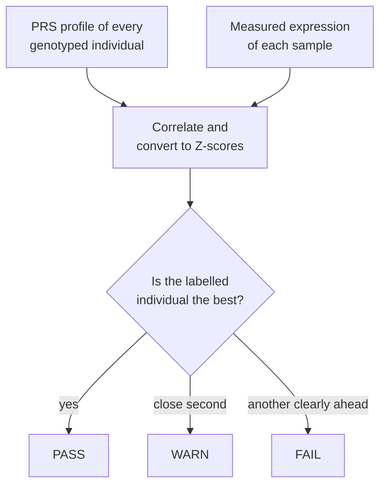

# Use case: is every expression sample paired with the right genotype?

This page checks sample identity in the MAGE example from start to finish. You need about
ten minutes. Each command takes a few seconds.

!!! abstract "In short"
    ```bash
    anqchor match run \
      --geno-list examples/mage/data/geno/mage.pgen_list.tsv \
      --pheno     examples/mage/data/pheno/mage_expr.chr21_22.regenie.tsv.gz \
      --cov       examples/mage/data/pheno/mage_covariates.regenie.tsv.gz \
      --pairs     examples/mage/data/reference/gtex_lcl_eqtl.chr21_22.tsv.gz \
      --out results/match
    anqchor match report --out results/match
    ```
    Then open `results/match/report/match.html`. On this data 713 of the 729 expression
    samples match their own genotype best and 14 match it only leniently. Two samples are
    unclear. One of them, `NA11919`, clearly does not match its own genotype (rank 253 of
    729), but no other individual stands out clearly enough to name the source.

## The question

In an xQTL study, every omics sample (here, an RNA-seq library) is linked to a genotyped
individual by its sample ID. Tubes get swapped, libraries get contaminated and spreadsheets
get sorted wrongly. If a link is wrong, that sample's genotypes and expression do not belong
together. This weakens every association and can create false ones.

**Why genetics can answer this.** Many genes have strong known cis-eQTLs, where one variant
changes the gene's expression by a known amount (`beta`). If you know an individual's
genotypes, you can predict whether each of these genes should be expressed higher or lower
than average in that individual. The predicted value is the sum of `beta × dosage`. This is a
polygenic score (PRS) per gene, although here it usually has one variant per gene. Across
hundreds of genes these predictions form a profile that fits only one person.



anqchor:

1. computes the PRS profile of every genotyped individual (`qpgentools pair-prs`);
2. correlates each expression sample's measured profile with every individual's predicted
   profile and converts the correlations into Z-scores (`qpgentools match-prs-pheno`);
3. checks whether the individual the sample is labelled with has the highest Z. If another
   individual is clearly ahead, the sample is a mismatch.

A single gene says almost nothing, but 367 genes together identify individuals reliably. On
this data, a correctly labelled sample's own genotype typically has Z ≈ 5.5, while the best
unrelated individual reaches Z ≈ 3.

The known eQTLs come from GTEx (EBV-transformed lymphocytes), whose donors are not in MAGE.
An independent reference matters: eQTLs discovered in the same samples would fit those
samples' own expression noise and make every match look stronger than it really is.

## Inputs

All files are in the repository under `examples/mage/data/`. The
[example data](example-data.md) page describes where they come from.

| File | What it is | Size |
|---|---|---|
| `geno/mage.pgen_list.tsv` | list of PLINK2 genotype files, one per chromosome | 729 individuals × 256,645 variants |
| `geno/mage_chr21.*`, `geno/mage_chr22.*` | `.pgen`, `.psam`, indexed `.pvar.idx.gz` (+ `.tbi`) | |
| `reference/gtex_lcl_eqtl.chr21_22.tsv.gz` | known cis-eQTLs from GTEx (the reference) | 367 gene–variant pairs, 346 variants |
| `pheno/mage_expr.chr21_22.regenie.tsv.gz` | expression (the omics data to check) | 729 samples × 367 genes |
| `pheno/mage_covariates.regenie.tsv.gz` | covariates removed from the expression first | 729 samples × 66 covariates |

**Genotype list** (`CHROM BEG END PREFIX`, no header). Relative prefixes are resolved next to
the list file:

```text
21	1	1000000000	mage_chr21
22	1	1000000000	mage_chr22
```

The `.psam` has only an `#IID` column:

```text
#IID
HG00096
HG00100
```

The indexed `.pvar.idx.gz` holds `CHROM POS ID REF ALT` plus the row number of each variant
in the `.pgen` (`INDEX`):

```text
#CHROM  POS      ID               REF  ALT  QUAL  FILTER  INFO  INDEX
21      5031747  21:5031747:G:GA  G    GA   .     .       .     1
21      5031747  21:5031748:GA:G  GA   G    .     .       .     2
```

The genotypes are the 729 individuals that have expression data, with every variant of
minor allele frequency ≥ 5% among them. They are unphased.

**Reference pairs** (tab-separated with a header; `pval` is optional). One row per GTEx
eGene: the gene and its sentinel (strongest) variant. Variant IDs are `CHROM:POS:REF:ALT`.
`beta` is the effect of one copy of `ALT` on the gene's expression:

```text
trait                          variant         beta       se         pval
ENSG00000275993.3:SIK1B        21:6122794:C:T  -0.448959  0.0888711  8.054e-07
ENSG00000278931.1:bP-2189O9.2  21:9370164:G:A  0.484109   0.10423    5.31901e-06
ENSG00000279720.1:SOWAHCP2     21:9088050:G:A  0.708996   0.180329   0.000107185
```

**Expression**, in [regenie layout](../user-guide/inputs.md): one row per sample with `FID`,
`IID`, then one column per gene. The gene IDs are identical to the reference `trait` IDs. The
sample IDs (`IID`) are identical to the genotype IDs, so no sample map is needed:

```text
FID      IID      ENSG00000275993.3:SIK1B  ENSG00000278931.1:bP-2189O9.2  ENSG00000279720.1:SOWAHCP2  ...
HG00096  HG00096  -0.238523                0.224454                       2.54496                     ...
HG00100  HG00100  -0.217436                -0.309645                      -0.0685407                  ...
```

**Covariates**, also in regenie layout: `sex`, `PC1`–`PC5`, `PEER1`–`PEER60`. `sex` is text
(`XX`/`XY`). anqchor detects that it is not numeric and passes it to qpgen as a categorical
covariate (`--cat-cov-names sex`), which qpgen encodes as an indicator column. Categories coded
as numbers, such as a batch number, need `--cat-cov-names batch`:

```text
FID      IID      sex  PC1         PC2        ...  PEER1       ...  PEER60
HG00096  HG00096  XY   -0.0216243  0.0487524  ...  -0.0565679  ...  ...
HG00100  HG00100  XX   -0.0215191  0.0503942  ...  0.0722641   ...  ...
```

## Run it

From the repository root:

```bash
anqchor match run \
  --geno-list examples/mage/data/geno/mage.pgen_list.tsv \
  --pheno     examples/mage/data/pheno/mage_expr.chr21_22.regenie.tsv.gz \
  --cov       examples/mage/data/pheno/mage_covariates.regenie.tsv.gz \
  --pairs     examples/mage/data/reference/gtex_lcl_eqtl.chr21_22.tsv.gz \
  --out results/match
```

```text
[anqchor] running prepare.genotypes
[anqchor] running prepare.reference.reference
[anqchor] running prepare.dataset.dataset
[anqchor] running prepare.mapping.dataset.reference
[anqchor] running prs.reference
[anqchor] running match.dataset.qpgen
[anqchor] running match.dataset.summarize
ran: prepare.genotypes, prepare.reference.reference, ..., match.dataset.qpgen, match.dataset.summarize
```

This takes about 8 seconds on a laptop. `match run` stops at the summary tables. Render the
HTML report from them (about 1 second, no analysis is run):

```bash
anqchor match report --out results/match
```

```text
match report: results/match/report/match.html
```

`anqchor match all` with the same flags does both in one command. Running `match run` again
with the same flags does nothing (`ran: nothing (all steps up to date)`).

What the flags mean:

- `--geno-list` is the genotype list. With a single PLINK2 fileset, use
  `--pfile path/prefix` instead.
- `--pheno` is the omics matrix to check.
- `--cov` holds covariates that are regressed out of the expression before matching. This
  removes sex, ancestry and hidden technical factors, so the remaining variation is driven
  more by the eQTL genotypes ([see its effect](#other-scoring-options)).
- `--pairs` is the reference: known xQTL effects.
- `--out` is the run directory.

The defaults that apply: rank-based inverse normal transform after the covariate adjustment
(`--rint`), genes scored as independent (`--independent`), `--z-threshold 1.96`,
`--z-diff 2`. With flag-only inputs the dataset and reference are called `dataset` and
`reference`, which appear in step names and output paths; `--dataset-name rnaseq
--reference-name gtex_lcl` changes them. Other flags you may need with your own data:
`--sample-map` when omics and genotype IDs differ ([example below](#try-it-yourself-a-sample-swap)),
`--trait-id-rule` when gene IDs differ (such as with or without the version), and
`--prs-samples` to restrict the candidate individuals.

!!! tip "The same run from a configuration file"
    `examples/mage/match.yaml` describes the same inputs and settings, with comments:

    ```bash
    anqchor match run --config examples/mage/match.yaml --out results/match_cfg
    ```

    It names the dataset `rnaseq` and the reference `gtex_lcl`, so its outputs are under
    `match/rnaseq/`. The calls are identical. Every run directory also holds
    `anqchor.resolved.yaml`, the complete settings of that run (flags included);
    `anqchor match run --config results/match/anqchor.resolved.yaml --out results/match_again`
    repeats it exactly.

## What comes out

```text
results/match/
├── match/dataset/
│   ├── summary.json           counts, verdict, failing samples, parameters
│   ├── samples.tsv            one row per expression sample
│   ├── swaps.tsv              reciprocal swaps and one-way mismatches
│   ├── candidates.tsv         rescue candidates (unlabelled samples with a clear match)
│   ├── duplicates.tsv         samples that match two genotype IDs about equally
│   ├── related.tsv            samples whose top matches include possible relatives
│   ├── weights.tsv            per-gene weight (how informative each gene is)
│   └── qpgen.*                qpgen's own outputs and the exact command line
├── prs/reference/             predicted expression (PRS) of every genotyped individual
├── prepare/                   normalised inputs; prepare/references/reference/reference.json
│                              reports 346 of 346 reference variants present
├── report/match.html          written by 'match report' (or 'match all')
├── logs/<step>.log            one log per step
├── anqchor.resolved.yaml      the complete settings of the run
└── run.json                   command lines, qpgen binary and commit, step times
```

### `summary.json`

The first lines to read:

```json
"group_counts":  {"FAIL": 0, "NO_TEST": 0, "PASS": 713, "WARN": 16},
"status_counts": {"SELF_BEST": 713, "SELF_LENIENT": 14, "UNCLEAR": 2, ...},
"verdict": "727 of 729 mapped samples confirmed (14 only leniently); 2 unclear",
"verdict_status": "warning",
"n_traits_used": 367, "n_traits_weight_le0": 14, "n_prs_samples": 729,
"n_reciprocal_swaps": 0, "n_rescue_candidates": 0, "n_duplicates": 0, "n_related": 8
```

- `verdict` is the one-sentence result. `verdict_status` is `critical` whenever at least one
  sample fails, `warning` when some are unclear, `good` otherwise.
- `group_counts` sums the statuses into four groups: `PASS` (own genotype is the best),
  `WARN` (own genotype is not the best, but nobody else is clearly ahead), `FAIL` (someone
  else is clearly ahead), `NO_TEST` (nothing to check, for example no label).
- `failing` lists each `FAIL` with its Z-scores and note.
- `weights` summarises how informative the genes are (the correlation of each gene's PRS
  with its measured expression). Here the median weight is 0.24 and 14 of the 367 genes
  have a weight ≤ 0. For 13 of them the GTEx effect does not show up in MAGE (p > 0.001
  for the reference variant with all covariates); for one, `HMGN1`, MAGE shows a strong
  effect in the opposite direction. Such genes carry no identity information. Many
  genes with weight ≤ 0 would point to a wrong gene mapping or a reference that does not
  fit the data (another tissue, wrong allele coding).

### `samples.tsv`

One row per expression sample. The most useful columns:

| Column | Meaning |
|---|---|
| `pheno_id`, `geno_id_assigned` | the expression sample and the genotype it is labelled with |
| `qpgen_status`, `group` | the call ([rules](../pipelines/match.md#status-rules)) and its group |
| `z_self`, `rank_self` | Z-score and rank of the labelled genotype among all 729 candidates |
| `best_id`, `z_best`, `second_id`, `z_second`, `z_gap` | the best and second-best genotypes and the gap between them |
| `proposed_geno_id`, `note` | suggested relabel (if any) and an explanation |
| `id_1`…`id_5`, `z_1`…`z_5` | the top five candidates |

A typical correct sample: the own genotype is first with Z 6.3, and the runner-up is at 3.1.

```text
pheno_id  geno_id_assigned  qpgen_status  group  z_self   rank_self  best_id  z_best   second_id  z_second  z_gap
HG00096   HG00096           SELF_BEST     PASS   6.29253  1          HG00096  6.29253  HG01250    3.05581   3.23672
```

The 16 samples that are not `PASS`:

```text
pheno_id  qpgen_status  group  z_self    rank_self  best_id  z_best   second_id  z_second  z_gap
HG00565   SELF_LENIENT  WARN   3.71448   2          HG03646  4.04383  HG00565    3.71448   0.329348
HG00956   SELF_LENIENT  WARN   2.9646    2          HG00335  3.3135   HG00956    2.9646    0.348897
HG02150   SELF_LENIENT  WARN   3.06601   2          HG03460  3.08733  HG02150    3.06601   0.021329
HG02471   SELF_LENIENT  WARN   3.86875   2          HG03897  4.27441  HG02471    3.86875   0.405662
HG02624   SELF_LENIENT  WARN   2.1106    4          HG02230  2.24674  HG03711    2.22891   0.017828
HG02817   SELF_LENIENT  WARN   2.39651   2          HG01939  3.151    HG02817    2.39651   0.754491
HG02851   SELF_LENIENT  WARN   3.19338   2          NA20762  3.58572  HG02851    3.19338   0.392339
HG03548   SELF_LENIENT  WARN   2.78168   3          NA12348  3.23288  NA20502    2.84918   0.383705
NA11919   UNCLEAR       WARN   0.406844  253        HG00237  3.59968  NA18553    3.27856   0.321118
NA12046   SELF_LENIENT  WARN   3.607     2          HG04141  3.82388  NA12046    3.607     0.216876
NA12717   UNCLEAR       WARN   1.93587   13         NA19404  2.70853  HG03105    2.67465   0.033889
NA18504   SELF_LENIENT  WARN   2.5518    3          NA12718  2.95362  NA20832    2.57327   0.380347
NA18516   SELF_LENIENT  WARN   3.47043   2          NA19795  3.6408   NA18516    3.47043   0.170375
NA19312   SELF_LENIENT  WARN   2.42348   6          NA19759  3.03244  HG01800    2.82344   0.208999
NA19430   SELF_LENIENT  WARN   2.50097   5          HG03910  3.48981  HG01920    3.1175    0.37231
NA19676   SELF_LENIENT  WARN   3.05647   2          NA20827  3.12578  NA19676    3.05647   0.069314
```

### `swaps.tsv`

Every `FAIL` sample appears here. Two samples whose best matches are each other's labels are
a `reciprocal` pair; any other `FAIL` is `one-way`, with the sample that holds its best
genotype as partner. The file is empty here because no sample fails. A real swap of two
samples appears as two rows of kind `reciprocal`
([see below](#try-it-yourself-a-sample-swap)).

### `candidates.tsv`

Rescue candidates are expression samples *without* a genotype label that clearly match a
genotyped individual (`candidate_geno_id`). The file is empty here because every sample is
labelled. With your own data, unlabelled samples appear here when the sample map leaves them
out ([example below](#try-it-yourself-samples-without-an-id)). A sample whose clear best
genotype is already the confirmed match of another sample is not a candidate.

### `duplicates.tsv`

Samples that match two genotype IDs about equally: the top two score alike (the second at
least 0.8 × the first) and both stand clear of every other genotype
([rule](../pipelines/match.md#status-rules)). The two genotypes are then most likely one
person. The file is empty here; [below](#try-it-yourself-a-genotype-listed-twice) is an
example with a duplicated genotype.

### `related.tsv`

8 samples have top candidates that start with a block of two or three individuals standing
out from the rest. One is usually the sample itself, and another has Z ≈ 3.5–4.8, about what
a close relative gives (1000 Genomes contains families). For example:

```text
pheno_id  group  n_close  close_ids                close_z
HG02429   PASS   2        HG02429,HG02479          6.441,4.782
NA12046   WARN   3        HG04141,NA12046,NA19717  3.824,3.607,3.524
```

This is for information only, does not change any call and is not shown in the report.
`assigned_in_close` says whether the labelled genotype is part of the block. Where the own
genotype scores well (Z 5–7.8, six samples), the relative scores 0.51–0.74 of the best, far
below the near-equal scores of a duplicated genotype. Where it scores weakly (`HG02574` at
4.0, `NA12046` at 3.6), the block is close to even; that is weak signal, not evidence of a
duplicate.

### `weights.tsv`

One row per gene: `trait`, `ref_trait` (the reference trait it came from), `weight`, `n_obs`
(samples observed) and `weight_le0` (1 when the gene carries no identity information).

## Reading the report

Open `results/match/report/match.html` in a browser. It is a single file that works
offline. From top to bottom:

- **Header**: the title, the counts (729 omics samples · 729 genotypes · 367 traits) and the
  scoring used. With the default independent scoring a short tip names
  [`--mahalanobis`](#mahalanobis).
- **Dashboard**: large tiles with the counts, number first. On this data: 729 with an
  assigned ID, 713 strict matches to their own ID, 727 lenient matches ("strict + 14"), 0
  samples that match another sample and 2 whose own ID is too weak (not the top match and
  at or below the lenient cutoff: `NA11919` and `NA12717`). "Matches two genotype IDs",
  "Matches several" and "Not scored" tiles appear when such samples exist, and a "No assigned
  ID" tile when some samples have no ID. Click a tile to filter the sample table. The same
  result names are used on the tiles, cards, chart legend, filters and table.
- **Sliders**: the lenient cutoff (`z_threshold`) and the clear lead (`z_diff`), each with a
  one-line hint, and one line explaining the match score. Moving
  either reclassifies every sample in your browser with the same rules qpgen uses, and the
  tiles, cards, chart, duplicates and table follow. A changed tile shows the run's count under its
  value. **Reset** returns to the run's values, and **Copy as config** copies the YAML lines
  that make new values permanent. The files in the run directory are not changed. Use this
  to explore the [trade-offs below](#how-the-thresholds-change-the-calls) without
  re-running.
- **Samples to check**: one card per sample that is not a strict match, with bars for the
  own-ID match score and the best other score, and the lenient cutoff as a dashed tick.
  Here 16 samples: the two whose own ID is too weak come first, then the lenient matches.
  At most 12 cards are shown, followed by "Show all 16 in table →". The `NA11919` card
  reads "Best: HG00237, ahead of next by 0.32 (needs more than 2.00). HG00237 also matches
  its own sample." Samples that match two genotype IDs and samples without an assigned ID
  get cards too; when more than six samples have no ID, one card summarises them. The report calls
  qpgen's Z-score the "match score".
- **How clearly each sample matches one genotype**: one point per sample, assigned or not:
  best match score across, runner-up score up. Below the dashed line (shaded, "one genotype
  clearly best") the best genotype leads the runner-up by more than the clear lead; the line moves
  with the slider (the shade is grey: a mismatch can lie there too). On the dotted diagonal
  the two tie. Strict matches form the green cloud
  at best 3–8.4 and runner-up 2.3–4.8. The 14 lenient points sit near the diagonal at
  2.2–4.3, and `NA11919` sits close to them at (3.6, 3.3): its own genotype is far down the
  list, but no other genotype clearly fits it either. A sample whose expression came from
  another genotyped individual would sit in the shaded part instead. Samples without an
  assigned ID are hollow markers; a duplicated genotype shows as a star on the diagonal far
  above the cloud.
- **Duplicates**: samples that match two genotype IDs about equally. None here ("No sample
  matches two genotype IDs."). Mismatches and relatives are not listed.
- **All samples**: every sample with its result, own score, own rank, best other ID, its
  score, lead (own score minus the best other score; negative when another genotype fits
  better, in red when that makes the sample a mismatch) and the suggested ID. For samples
  without an assigned ID the lead is the best genotype's lead over the next, in italics. The
  page scrolls and the header stays on screen. On a phone the table keeps sample, result,
  own score and lead, and shows the best other genotype under the sample ID. Search by ID, filter by result, sort by any column, show 100, 500 (the
  default) or all rows per page, and download the view as TSV.
- **Run details** (collapsed): the settings, a histogram of gene weights (−0.35 to 0.80
  here, 14 genes at or below zero), the result names and the matching codes in `samples.tsv`, the qpgen
  command line and the qpgen log.

The report uses plain names for the qpgen statuses:

| Report | `samples.tsv` `qpgen_status` |
|---|---|
| Strict match | `SELF_BEST` |
| Lenient match | `SELF_LENIENT` |
| Matches another sample (assigned ID) / New ID found or ID already used (no assigned ID) | `SINGLE_NEW_BEST` |
| Matches several | `MULTI_NEW_BEST` |
| Matches two genotype IDs (about equally, one of them the own ID or no ID assigned) | `SINGLE_NEW_BEST` or `MULTI_NEW_BEST` |
| Own ID too weak | `UNCLEAR` |
| No clear match (no assigned ID) | `NO_SELF` |
| Not scored | `NO_OBS_TRAITS`, `NOT_SCORED` |

## What the results mean on this data

**`NA11919`: the expression does not come from `NA11919`, and its source cannot be
named.** Its own genotype reaches only Z 0.41 and ranks 253rd of 729, which is background
level; a correctly labelled sample typically reaches Z ≈ 5.5. So the label is almost
certainly wrong. The best candidate is `HG00237` (Z 3.60), and it stays the best with every
scoring option on this page ([below](#other-scoring-options)). But it leads the runner-up
(`NA18553`, Z 3.28) by only 0.32, far below the clear lead of 2, and Z 3.6 is a score that
the best *unrelated* individual often reaches for other samples. qpgen therefore calls the
sample `UNCLEAR` (`WARN`, "Own ID too weak" in the report) and names no new ID. Moreover,
`HG00237` has its own expression sample, which matches `HG00237` normally (`PASS`, Z 5.17),
so even a clear lead would not lead to a relabel: one individual would get two libraries.

The `NA11919` library may come from someone who is not among the 729 genotyped individuals,
be a mixture, or be of poor quality. **Action:** exclude `NA11919` from downstream analyses
and check the lab records. Do not rename it.

**`NA12717` is most likely weak signal.** Its own genotype ranks 13th (Z 1.94), but every
candidate, including the best (`NA19404`, Z 2.71), is at background level and the best leads
by only 0.03. Nothing points to another individual, and with `--mahalanobis` (own ID 6th,
lenient) or without covariates (own ID first) it is confirmed. Keep it, but note it.

**The 14 lenient (`WARN`) samples are weak signal, not errors.** Their own genotype is a
close second to sixth (Z 2.1–3.9), at most 0.75 behind the best, and none has a clear
alternative individual. Their expression carries less eQTL signal on these 367 genes. A
larger reference (more genes, or genome-wide eQTLs) would most likely confirm them.

### When the true source is not genotyped { #why-729-genotypes-are-enough }

Matching can only name the individual an expression sample really comes from when that
individual's genotypes are among the candidates. Here all 729 individuals with expression
data are candidates, yet `NA11919` has no clear match: its source may be missing, or the
signal may be too weak to name it.

To see how a sample behaves when its candidate disappears, leave `HG00237`, the best
candidate for `NA11919`, out of the candidates with `--prs-samples` (a file with the other
728 IDs):

```bash
mkdir -p results
grep -v -e '^#' -e '^HG00237$' examples/mage/data/geno/mage_chr21.psam > results/without_HG00237.txt
anqchor match run \
  --geno-list examples/mage/data/geno/mage.pgen_list.tsv \
  --pheno     examples/mage/data/pheno/mage_expr.chr21_22.regenie.tsv.gz \
  --cov       examples/mage/data/pheno/mage_covariates.regenie.tsv.gz \
  --pairs     examples/mage/data/reference/gtex_lcl_eqtl.chr21_22.tsv.gz \
  --prs-samples results/without_HG00237.txt \
  --out results/match_noHG00237
```

`NA11919` stays `UNCLEAR` (`WARN`). Its own genotype is still at background level (Z 0.41),
and the new best, `NA18553` at Z 3.31, leads the next (`HG02023`, Z 3.23) by only 0.08: no
individual stands out. The expression sample `HG00237` has no genotype candidate any more
and becomes `NO_SELF` (`NO_TEST`); its best remaining genotype, `NA18626` at Z 3.15, is at
background level, as expected when the true source is missing.

**With your own data, include every genotyped individual you have**, not only those with
omics data. This is the default. Extra individuals let anqchor name the source of a
mislabelled sample and rescue unlabelled samples, and they make it more likely that
relatives are among the candidates. Note that more candidates also raise the background: the
best unrelated individual scores higher when there are more of them to choose from. A
borderline call can then change. For example, a mismatch whose gap is just above `z_diff`
with the 729 candidates here could fall just below it with a larger genotype set and become
`UNCLEAR` instead of `FAIL`, or the reverse. Calls with a large gap do not change.

## How the thresholds change the calls

`z_threshold` and `z_diff` only decide what happens to samples whose own genotype is *not*
the best. `SELF_BEST` (PASS) does not depend on them. To see the effect, re-run `match run`
into the same output directory with new values:

```bash
anqchor match run \
  --geno-list examples/mage/data/geno/mage.pgen_list.tsv \
  --pheno     examples/mage/data/pheno/mage_expr.chr21_22.regenie.tsv.gz \
  --cov       examples/mage/data/pheno/mage_covariates.regenie.tsv.gz \
  --pairs     examples/mage/data/reference/gtex_lcl_eqtl.chr21_22.tsv.gz \
  --z-threshold 3 --z-diff 1 \
  --out results/match
```

```text
[anqchor] running match.dataset.qpgen
[anqchor] running match.dataset.summarize
ran: match.dataset.qpgen, match.dataset.summarize
match report: results/match/report/match.html is older than the results; update it with 'anqchor match report --out results/match'
```

Only the matching and summary steps re-run; the prepared inputs and the PRS are reused. The
report is **not** updated by `match run`, as the last line says: run
`anqchor match report --out results/match` again to see the new values in it. Results on this data:

The columns use the report's names (`qpgen_status` in brackets); `duplicates.tsv` and
`related.tsv` are the numbers of samples listed there.

| `z_threshold` | `z_diff` | Strict match (`SELF_BEST`) | Lenient only (`SELF_LENIENT`) | Matches another sample (`SINGLE_NEW_BEST`) | Two genotype IDs or matches several (`MULTI_NEW_BEST`) | Own ID too weak (`UNCLEAR`) | `duplicates.tsv` | `related.tsv` |
|---|---|---|---|---|---|---|---|---|
| 1.96 | 1 | 713 | 13 | 0 | 1 | 2 | 1 | 7 |
| **1.96** | **2** | **713** | **14** | **0** | **0** | **2** | **0** | **8** (default) |
| 1.96 | 3 | 713 | 14 | 0 | 0 | 2 | 0 | 8 |
| 3 | 1 | 713 | 6 | 0 | 1 | 9 | 1 | 7 |
| 3 | 2 | 713 | 7 | 0 | 0 | 9 | 0 | 8 |
| 3 | 3 | 713 | 7 | 0 | 0 | 9 | 0 | 8 |
| 5 | 1 | 713 | 0 | 0 | 1 | 15 | 0 | 0 |
| 5 | 2 | 713 | 0 | 0 | 0 | 16 | 0 | 0 |
| 5 | 3 | 713 | 0 | 0 | 0 | 16 | 0 | 0 |

How to read it:

- **`z_diff` controls how easily a sample fails.** No sample has a best match more than 0.76
  ahead of the runner-up unless it is its own genotype, so at `z_diff` 2 and 3 nothing
  fails. At `z_diff 1`, two samples are flagged, and both are false alarms. `NA12046` becomes
  `MULTI_NEW_BEST` ("Matches several", a `FAIL`): its top three, `HG04141` (3.82), itself
  (3.61) and `NA19717` (3.52), are more than 1 ahead of the fourth (2.38). `HG02574` stays a
  strict match but is listed in `duplicates.tsv`: it scores 4.00 and `HG03091` 3.81, both
  more than 1 ahead of the third (2.76). All these scores are at the level of weak true
  matches. A small `z_diff` flags more and catches subtle problems, but also produces false
  alarms. A large one flags only very clear mismatches.
- **`z_threshold` decides lenient versus unclear.** It moves samples between
  `SELF_LENIENT` ("own genotype is still good") and `UNCLEAR` ("cannot tell"), and never
  changes strict matches or samples that match another sample. At 3, 7 of the 14 lenient
  samples (own Z 2.1–2.96) become `UNCLEAR`. At 5, all 14 do. `NA11919` and `NA12717` are
  `UNCLEAR` at every setting. The [possible-relatives](../pipelines/match.md#status-rules)
  flag also requires Z ≥ `z_threshold`, so at 5 no relatives are listed.
- The default 1.96 / 2 is a sensible start. With few reference genes (weaker Z overall),
  consider a lower `z_diff`, then inspect every sample that matches another sample by hand.

The sliders in the report give the same counts instantly, without a re-run.

## Other scoring options

Each row is the command from [Run it](#run-it) with the option added, into a new `--out`
directory (or the same one: only the matching and summary steps re-run):

| Option | Effect on this data |
|---|---|
| none (covariates, `--rint`, independent traits) | 713 strict, 14 lenient only, 2 own ID too weak (`NA11919`, `NA12717`) |
| `--mahalanobis` | better; see [Independent vs Mahalanobis scoring](#mahalanobis) |
| `--no-rint` | 714 strict, 13 lenient only, the same 2 own ID too weak (`NA11919`: own Z 0.40, best `HG00237` at 3.83, gap 0.46) |
| `--no-use-cov` | **678 strict, 47 lenient only, 4 own ID too weak.** `NA11919` stays `UNCLEAR` (own Z 0.49, best still `HG00237` at 3.27, gap 0.52), while `NA12717` becomes a strict match. The median gene weight falls from 0.24 to 0.16, and 28 genes instead of 14 get weight ≤ 0. |

Removing the covariates (sex, ancestry PCs, PEER factors) matters most. Without the
adjustment, shared non-genetic expression variation hides the eQTL signal. Keep the
covariate adjustment when you have good covariates. Mahalanobis scoring accounts for
correlated genes, for example several eQTL genes in one region; it is slower on large
references. `--lambda` has an effect only together with `--mahalanobis`; on its own it is
accepted and ignored.

## Independent vs Mahalanobis scoring {#mahalanobis}

By default each trait (here, each gene) is scored independently. `--mahalanobis` accounts
for correlation between traits, with a shrinkage λ chosen automatically (0.58 here; the
report shows it under Run details). Run both into separate directories:

```bash
anqchor match run \
  --geno-list examples/mage/data/geno/mage.pgen_list.tsv \
  --pheno     examples/mage/data/pheno/mage_expr.chr21_22.regenie.tsv.gz \
  --cov       examples/mage/data/pheno/mage_covariates.regenie.tsv.gz \
  --pairs     examples/mage/data/reference/gtex_lcl_eqtl.chr21_22.tsv.gz \
  --out results/match_indep

anqchor match run \
  --geno-list examples/mage/data/geno/mage.pgen_list.tsv \
  --pheno     examples/mage/data/pheno/mage_expr.chr21_22.regenie.tsv.gz \
  --cov       examples/mage/data/pheno/mage_covariates.regenie.tsv.gz \
  --pairs     examples/mage/data/reference/gtex_lcl_eqtl.chr21_22.tsv.gz \
  --mahalanobis \
  --out results/match_maha
```

| Scoring | Strict match | Lenient only | Own ID too weak | Matches another sample | Mean own-ID match score (Z) |
|---|---|---|---|---|---|
| independent traits (default) | 713 | 14 | 2 | 0 | 5.42 |
| `--mahalanobis` (auto λ 0.58) | 724 | 4 | 1 | 0 | 5.89 |

Mahalanobis scoring accounts for correlation between traits and matched better on this
example: 11 more strict matches, and only `NA11919` remains `UNCLEAR`. Its own genotype is
still at background level (Z 0.74, rank 161), and `HG00237` is still its best match, now at
Z 4.31, but only 0.68 ahead of the runner-up (`NA18553`, 3.64): still no clear lead.

## Try it yourself: a sample swap

Make a sample map that swaps the labels of `HG00096` and `HG00100` and keeps everyone else
unchanged. A sample map is a TSV with header `geno_id pheno_id`. Each row says "expression
sample `pheno_id` is labelled with genotype `geno_id`":

```bash
mkdir -p results
awk 'BEGIN { OFS = "\t"; print "geno_id", "pheno_id" }
     !/^#/ { p = $1
             if (p == "HG00096") p = "HG00100"; else if (p == "HG00100") p = "HG00096"
             print $1, p }' examples/mage/data/geno/mage_chr21.psam > results/swapped_map.tsv
head -3 results/swapped_map.tsv
```

```text
geno_id	pheno_id
HG00096	HG00100
HG00100	HG00096
```

Run with the map:

```bash
anqchor match run \
  --geno-list examples/mage/data/geno/mage.pgen_list.tsv \
  --pheno     examples/mage/data/pheno/mage_expr.chr21_22.regenie.tsv.gz \
  --cov       examples/mage/data/pheno/mage_covariates.regenie.tsv.gz \
  --pairs     examples/mage/data/reference/gtex_lcl_eqtl.chr21_22.tsv.gz \
  --sample-map results/swapped_map.tsv \
  --out results/match_swap
anqchor match report --out results/match_swap
```

anqchor flags both samples and pairs them as a reciprocal swap (from `summary.json`):

```text
verdict: 725 of 729 mapped samples confirmed (14 only leniently); 1 mismatch
         (HG00096 (labelled HG00100) best matches HG00096); 3 unclear
group_counts: PASS 711, WARN 17, FAIL 1;  n_reciprocal_swaps: 1
```

`swaps.tsv`:

```text
kind        pheno_id  geno_id_assigned  group  best_id  z_best   z_self     rank_self  partner_pheno_id
reciprocal  HG00096   HG00100           FAIL   HG00096  6.23703  0.831925   138        HG00100
reciprocal  HG00100   HG00096           WARN   HG00100  4.65304  -1.05686   627        HG00096
```

With the wrong labels the own genotypes score at background level or below zero, and each
sample's best match is the other label. The two calls differ: `HG00096` (labelled `HG00100`)
leads its runner-up by 3.19 and is a mismatch (`FAIL`) with `proposed_geno_id` `HG00096`;
`HG00100` (labelled `HG00096`) leads by only 1.76, just below `z_diff 2`, so it is `UNCLEAR`
(`WARN`) and gets no proposal. Because one side is a clear mismatch and the best matches
point at each other, the pair still counts as a reciprocal swap: relabelling both resolves
it. With `--z-diff 1.5` both would be `FAIL`. This is one reason not to set `z_diff` too
high. The Z-scores of other samples move slightly (`NA11919`'s best, `HG00237`: 3.61 instead
of 3.60) because the gene weights are estimated from the mapped samples, which now include
two wrong pairs.

!!! note "After matching"
    `cis` and `trans` do not read the match results and do not accept a sample map. Fix the
    sample IDs in your input files (or drop the bad samples) before you run them.

## Try it yourself: samples without an ID { #try-it-yourself-samples-without-an-id }

Rename five expression samples (in the expression and covariate files) so that no genotype
carries their ID:

```bash
mkdir -p results/noid
for f in mage_expr.chr21_22 mage_covariates; do
  zcat < examples/mage/data/pheno/$f.regenie.tsv.gz |
    awk 'BEGIN { FS = OFS = "\t" }
         $2 ~ /^(HG00096|HG02282|HG03127|NA11919|NA12717)$/ { $2 = "_" $2; $1 = $2 } 1' |
    gzip > results/noid/$f.tsv.gz
done
anqchor match all \
  --geno-list examples/mage/data/geno/mage.pgen_list.tsv \
  --pheno     results/noid/mage_expr.chr21_22.tsv.gz \
  --cov       results/noid/mage_covariates.tsv.gz \
  --pairs     examples/mage/data/reference/gtex_lcl_eqtl.chr21_22.tsv.gz \
  --out results/match_noid
```

The "No assigned ID" tile shows 5: "1 new ID found · 4 no clear match". Each of the five
gets a card, and each is a hollow marker in the chart:

| Sample | Result | Best genotype (score) | Next (score) |
|---|---|---|---|
| `_HG00096` | New ID found | `HG00096` (6.23) | 3.07 |
| `_HG02282` | No clear match; "Best: HG02282, ahead of next by 1.19 (needs more than 2.00). No other sample has HG02282." | `HG02282` (4.21) | 3.02 |
| `_HG03127` | No clear match; "Best: HG03127, ahead of next by 1.08 (needs more than 2.00). No other sample has HG03127." | `HG03127` (4.46) | 3.38 |
| `_NA11919` | No clear match; "Best: HG00237, ahead of next by 0.31 (needs more than 2.00)." | `HG00237` (3.60) | 3.29 |
| `_NA12717` | No clear match | `NA19404` (2.70) | 2.69 |

`candidates.tsv` lists the one new ID. The best genotypes of `_HG02282` and `_HG03127` are
right, but their leads (1.19 and 1.08) are below the clear lead, so no ID is suggested; that
no other sample holds that genotype is weaker evidence, shown only as a note. A sample
without an ID whose clear best genotype is already the confirmed match of another sample is
shown as "ID already used" instead of "New ID found"; none occurs here.

With many samples without an ID, one summary card replaces the individual cards. Renaming
150 random samples the same way gives "100 new ID found · 50 no clear match": the best
genotype is the right one for 148 of the 150, and for 48 of the 50 with no clear match the
best genotype isn't used by any other sample, so it is probably theirs (shown as a hint, no
ID is suggested). In the table these rows show the best genotype and, in italics, its lead
over the next. Fewer labelled samples also change the gene weights a little, so Z-scores
near a threshold can move: `NA11919` (not renamed) then leads by 0.24 instead of 0.32.

Samples renamed in the expression file only have no covariates: qpgen does not score them
(`NOT_SCORED`, "Not scored"), and the report shows the warning "5 samples not scored: no
covariates" and one card listing them.

## Try it yourself: a genotype listed twice { #try-it-yourself-a-genotype-listed-twice }

A person genotyped twice under two IDs (or identical twins) makes an omics sample match two
genotype IDs equally well. With `HG00096`'s genotypes copied under a second ID (made with
plink2), the expression sample `HG00096` scores 6.14 against both, and 2.97 against the
next. Its own ID still ranks first, so it stays a strict match, and the report lists it
under **Duplicates** with a card ("HG00096 and HG00096_dup are probably one person").

When the copy differs slightly (the original renamed `HG00096_twin`, and a copy with 2% of
its genotype calls changed at random kept as `HG00096`), the original scores 6.16 and the own
ID 5.55; the exact values depend on which calls change. qpgen calls this
`MULTI_NEW_BEST`, a `FAIL`; the report shows "Matches two genotype IDs" (with its own
tile), not a mismatch. `duplicates.tsv` has the row; the verdict, `n_fail`, `failing` and
`swaps.tsv` leave it out (`n_fail_two_ids` counts it), and no relabel is proposed. For a
sample without an assigned ID matching both copies, the result is "Matches two genotype
IDs" too, with no suggested ID.

A weak duplicate is not flagged: copying `HG03127`, whose own score is only 4.50, gives two
equal scores that do not stand clear of the background (third best 3.31). It is listed in
`related.tsv` as a possible relative instead.

## Common errors

| Message | Cause and fix |
|---|---|
| `error: give --config FILE, or the input flags (see --help)` | No inputs were given. Add `--geno-list` (or `--pfile`), `--pheno` and `--pairs`. |
| `error: run failed in step prepare.dataset.dataset; log: …/logs/prepare.dataset.dataset.log`, and in the log `…map.tsv: expected a header with columns 'geno_id pheno_id' (or 'NWD_ID SAMPLE_ID'), got 'HG00096\tHG00100'` | The sample map has no header line. Add `geno_id<TAB>pheno_id` as the first line. |
| `error: invalid configuration: pipelines.match.z_diff: Input should be greater than or equal to 0` | `--z-diff` must be ≥ 0. |
| `error: invalid configuration: pipelines.match.lambda: Value error, lambda must be 'auto' or between 0 and 1` | `--lambda` must be `auto` or a number in [0, 1]. |
| `error: invalid configuration: pipelines.match.z_dif: Extra inputs are not permitted` | A misspelt key in a configuration file. Unknown keys are always errors (exit code 2). |
| `error: … is not an anqchor run directory (no anqchor.resolved.yaml)` | `match report --out` points to a directory that `match run` did not write. |
| `error: missing inputs (run the analysis first):` followed by `match/<ds>/samples.tsv` … | `match report` on a run that has not finished its summary step. Run `match run` first. |
| Many `NO_TEST` / `NO_SELF` samples | Expression IDs do not match genotype IDs. Add `--sample-map`. |
| Few genes used, or many genes with weight ≤ 0 | Gene IDs differ between reference and expression (for example `ENSG…5` vs `ENSG…5.14:GENE`). Set `--trait-id-rule` (such as `before_colon_strip_version`) or give a `trait_map` in a configuration file. |
| `run failed in step …; log: …/logs/<step>.log` | Open that log; it holds the full error and the qpgen command. |

## What to try next

- Change the thresholds with the report's sliders. Use **Copy as config**, or re-run
  `match run` with `--z-threshold` / `--z-diff`, to make them permanent.
- Try `--mahalanobis` (`--lambda auto`) when your reference genes are correlated.
- Run the identity check on your own data: the same four input flags, plus `--sample-map`
  when omics IDs differ from genotype IDs.
- Once identities are fixed, evaluate your analysis setup with
  [cis evaluation](cis-strategies.md).
- The full status rules, swap and relative detection and every output column:
  [match pipeline](../pipelines/match.md).
