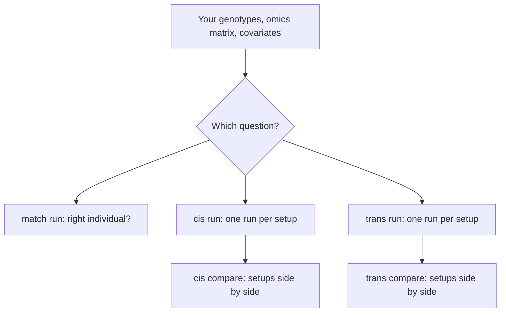

# Use cases

anqchor answers three questions about an xQTL study. Each one is a **separate analysis**
with its own command, its own inputs and its own run directory. Run the one you need;
there is no reason to run them together.

| Analysis | Question | Command | Walk-through |
|---|---|---|---|
| Identity matching | Does each omics sample come from the individual it is labelled with? | `anqchor match run` | [Sample identity](identity-matching.md) |
| cis evaluation | How many known cis pairs replicate with these inputs and covariates? | `anqchor cis run`, then `anqchor cis compare` | [Comparing cis runs](cis-strategies.md) |
| trans evaluation | Do known pairs replicate, do hotspots appear, is the trans scan calibrated? | `anqchor trans run`, then `anqchor trans compare` | [trans evaluation](trans-strategies.md) |

Every example on these pages uses the compact MAGE chromosome 21/22 data that ships with
the repository in `examples/mage/data/`. The [example data](example-data.md) page
describes each file. Commands are run from the repository root.



## When to use each

**Identity matching** comes first, before any association analysis. Use it when omics
samples arrive from a lab or a sequencing core, when you merge batches, and whenever a
sample label may have been mixed up. It needs no association test, only the known
xQTL effects. The result tells you which samples to keep, relabel or drop before you run
cis or trans analyses.

**cis evaluation** helps you choose analysis settings. It tests only the known cis pairs
of a reference, so one run takes seconds. Run it once for each setup you are considering
(no covariates, a few PCs, PEER factors, another normalisation, another genotype
release), then compare the runs. The setup that replicates more known pairs has more
power for those pairs.

**trans evaluation** tests every variant of the known pairs against every gene of the known
pairs. It reports the known cis and trans pairs that replicate, hotspots (1-Mb regions whose
variants have trans signals for many genes) at a range of thresholds, and the inflation
(λ_GC, QQ plot) of the cross-chromosome tests. Use it to pick covariates before a
genome-wide trans scan.

## Inputs each analysis needs

| Input | Flag | match | cis | trans |
|---|---|---|---|---|
| Genotypes (PLINK 2 pgen with indexed pvar) | `--geno-list` or `--pfile` | required | required | required |
| Omics matrix (samples × traits) | `--pheno` | required | required | required |
| Covariates (samples × covariates) | `--cov` | recommended | optional | recommended |
| Reference xQTL pairs (`trait variant beta se [pval]`) | `--pairs` | required | required | required (or `--variants`) |
| Trait loci (BED-like) | `--trait-annot` | not used | only for `--assoc-engine rect` | required |
| Genotype ID ↔ omics ID map | `--sample-map` | when IDs differ | not accepted | not accepted |

cis and trans require the omics sample IDs to equal the genotype IDs. Fix labels found by
identity matching (or drop those samples) first. The formats are described in
[Inputs](../user-guide/inputs.md).

## The commands on the example data

=== "Identity matching"

    ```bash
    anqchor match all \
      --geno-list examples/mage/data/geno/mage.pgen_list.tsv \
      --pheno examples/mage/data/pheno/mage_expr.chr21_22.regenie.tsv.gz \
      --cov examples/mage/data/pheno/mage_covariates.regenie.tsv.gz \
      --pairs examples/mage/data/reference/gtex_lcl_eqtl.chr21_22.tsv.gz \
      --out results/match
    ```

    `match all` runs the analysis and writes `results/match/report/match.html`.
    `match run` stops at the summary tables, and `match report --out results/match`
    re-renders the HTML from them in about a second.

=== "cis evaluation"

    One run per setup. The runs are independent, so they can run at the same time.

    ```bash
    D=examples/mage/data

    # no covariates
    anqchor cis run --geno-list $D/geno/mage.pgen_list.tsv \
      --pheno $D/pheno/mage_expr.chr21_22.regenie.tsv.gz \
      --pairs $D/reference/gtex_lcl_eqtl.chr21_22.tsv.gz \
      --out results/cis/nocov

    # 6 covariates
    anqchor cis run --geno-list $D/geno/mage.pgen_list.tsv \
      --pheno $D/pheno/mage_expr.chr21_22.regenie.tsv.gz \
      --pairs $D/reference/gtex_lcl_eqtl.chr21_22.tsv.gz \
      --cov $D/pheno/mage_covariates.regenie.tsv.gz \
      --cov-include sex,PC1-5 \
      --out results/cis/basic

    # 16 covariates
    anqchor cis run --geno-list $D/geno/mage.pgen_list.tsv \
      --pheno $D/pheno/mage_expr.chr21_22.regenie.tsv.gz \
      --pairs $D/reference/gtex_lcl_eqtl.chr21_22.tsv.gz \
      --cov $D/pheno/mage_covariates.regenie.tsv.gz \
      --cov-include sex,PC1-5,PEER1-10 \
      --out results/cis/peer10

    # all 66 covariates
    anqchor cis run --geno-list $D/geno/mage.pgen_list.tsv \
      --pheno $D/pheno/mage_expr.chr21_22.regenie.tsv.gz \
      --pairs $D/reference/gtex_lcl_eqtl.chr21_22.tsv.gz \
      --cov $D/pheno/mage_covariates.regenie.tsv.gz \
      --out results/cis/peer60

    # compare the four runs
    anqchor cis compare results/cis/nocov results/cis/basic results/cis/peer10 results/cis/peer60 \
      --out results/cis/compare
    ```

    The comparison writes tables and `results/cis/compare/report/cis.html`. Each run is
    labelled with its directory name unless you give `--label`.

=== "trans evaluation"

    One run per covariate set, as for cis. trans also needs the gene loci
    (`--trait-annot`) to tell cis from trans cells.

    ```bash
    D=examples/mage/data

    # no covariates
    anqchor trans run --geno-list $D/geno/mage.pgen_list.tsv \
      --pheno $D/pheno/mage_expr.chr21_22.regenie.tsv.gz \
      --pairs $D/reference/gtex_lcl_eqtl.chr21_22.tsv.gz \
      --trait-annot $D/pheno/mage_genes.chr21_22.bed \
      --out results/trans/nocov

    # 6 covariates
    anqchor trans run --geno-list $D/geno/mage.pgen_list.tsv \
      --pheno $D/pheno/mage_expr.chr21_22.regenie.tsv.gz \
      --pairs $D/reference/gtex_lcl_eqtl.chr21_22.tsv.gz \
      --trait-annot $D/pheno/mage_genes.chr21_22.bed \
      --cov $D/pheno/mage_covariates.regenie.tsv.gz \
      --cov-include sex,PC1-5 \
      --out results/trans/basic

    # 16 covariates
    anqchor trans run --geno-list $D/geno/mage.pgen_list.tsv \
      --pheno $D/pheno/mage_expr.chr21_22.regenie.tsv.gz \
      --pairs $D/reference/gtex_lcl_eqtl.chr21_22.tsv.gz \
      --trait-annot $D/pheno/mage_genes.chr21_22.bed \
      --cov $D/pheno/mage_covariates.regenie.tsv.gz \
      --cov-include sex,PC1-5,PEER1-10 \
      --out results/trans/peer10

    # all 66 covariates
    anqchor trans run --geno-list $D/geno/mage.pgen_list.tsv \
      --pheno $D/pheno/mage_expr.chr21_22.regenie.tsv.gz \
      --pairs $D/reference/gtex_lcl_eqtl.chr21_22.tsv.gz \
      --trait-annot $D/pheno/mage_genes.chr21_22.bed \
      --cov $D/pheno/mage_covariates.regenie.tsv.gz \
      --out results/trans/peer60
    ```

    Then put the runs side by side:

    ```bash
    anqchor trans compare results/trans/nocov results/trans/basic results/trans/peer10 \
      results/trans/peer60 --out results/trans/compare
    ```

    This writes the comparison tables and `results/trans/compare/report/trans.html`;
    `anqchor trans report --out results/trans/compare` re-renders the page later. Each run
    is labelled with its directory name unless you give `--label`. The
    [trans use case](trans-strategies.md) adds a fifth run with `--rint`.

## Runtime on the example

Measured on a laptop (Apple M2 Max) with qpgen 0.2.0. The data is 729 samples ×
367 genes × 256,645 variants on chromosomes 21 and 22.

| Command | Wall time | What runs |
|---|---|---|
| `match all` | 8 s | PRS for 729 genotypes, matching, summaries, report |
| `match report` | 1 s | report only |
| `cis run` (one setup) | 6 s | 367 known pairs |
| four `cis run` at once | 6 s | four independent runs |
| `cis compare` (four runs) | 1 s | tables and report |
| `trans run` (one setup) | 8 s | 346 variants × 367 genes |
| four `trans run` at once | 9 s | four independent runs |
| `trans compare` (four runs) | 1 s | tables and report |
| `trans report` | 1 s | report only |

Re-running a finished command with the same settings does nothing and returns at once.
Changing a setting re-runs only the steps it affects.

## What the example shows

- **Identity matching:** 727 of 729 samples are confirmed (14 only leniently). Two are
  unclear. One of them, `NA11919`, does not match its own genotypes (rank 253 of 729); its
  best candidate, `HG00237`, leads the next by only 0.32, so no source is named. Exclude
  such a sample and check the lab records.
- **cis evaluation:** the known pairs come from GTEx, independent of these samples. With
  no covariates, 178 of the 367 known pairs replicate at p < 10⁻⁵; with sex and 5 PCs,
  162; adding 10 PEER factors, 231; with all 66 covariates, 251.
- **trans evaluation:** without covariates the cross-chromosome λ_GC is 1.74 and 37
  hotspots appear (1-Mb bins with trans signals for ≥ 5 genes at p < 1e-5). Every
  covariate setup brings λ_GC to between 1.00 and 1.02 (1.02 with sex and 5 PCs, 1.00 with
  10 or 60 PEER factors added) with no hotspot and no trans signal at Bonferroni. The
  reference is cis only, so cis replication matches the cis evaluation and the report
  shows no trans pairs.

!!! note "The example reference is independent"
    The known pairs are GTEx eGenes of EBV-transformed lymphocytes, discovered in GTEx
    donors, not in the MAGE samples. No setup is favoured by the way the pairs were
    chosen, so the comparisons measure power. Use an independent reference with your own
    data too: pairs discovered in the same samples with the same covariates favour that
    setup.

## Reproducing a run

Every run directory holds `anqchor.resolved.yaml`, the complete settings of the run,
including those given as flags. To repeat a run exactly:

```bash
anqchor cis run --config results/cis/peer10/anqchor.resolved.yaml --out results/cis/peer10_again
```

`run.json` in the same directory records each command line that ran in it, the anqchor
version, the qpgen binary with its git commit and checksum, and the time each step took.
