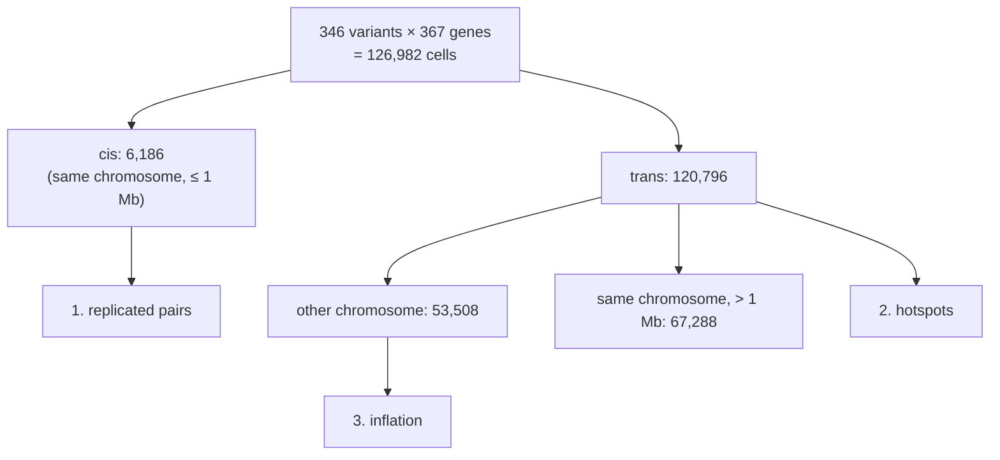

# Use case: trans evaluation

**Question.** Before you scan for trans-eQTLs (a variant affecting a gene far away), you want
to know three things about your analysis setup:

1. Does it recover the **known** eQTLs, cis and trans?
2. Does it report **hotspots**, regions whose variants seem to affect many genes, and do
   they survive good covariates?
3. Are its p-values **calibrated**: when there is no real effect, do they behave like
   p-values, or are false positives inflated?

This page runs `anqchor trans` on the compact MAGE example shipped with the repository, once
for each of five setups (no covariates, three covariate sets, and RINT), compares the five
runs and walks through the results.

!!! note "Three commands"
    1. `anqchor trans run`, once per setup: tests one setup and writes its own run directory.
    2. `anqchor trans compare RUN_DIR... --out DIR`: puts the runs side by side and writes
       one report.
    3. `anqchor trans report --out DIR`: re-renders that report later, in about a second.

    The trans analysis runs on its own, separately from `match` and `cis`.

## What anqchor tests

anqchor tests a **rectangle**: every variant of the reference pairs against every gene of
the reference pairs. Here the reference is 367 GTEx eQTL pairs with 346 distinct variants, so
the rectangle is 346 variants × 367 genes = 126,982 tests ("cells"), each a linear
regression of the gene's expression on the variant's genotype.



**cis or trans.** A pair is **cis** when the variant is on the gene's chromosome within
1 Mb (`--cis-window-bp`) of the gene's start (TSS). Every other pair is **trans**: on another
chromosome, or on the same chromosome more than 1 Mb away. The gene positions come from
`--trait-annot`.

**1. Replicated reference pairs.** Each reference pair is one cell of the rectangle. It
replicates when the effect has the reference's sign, and at stricter levels also p < 0.05 or
p < 1e-5. cis and trans pairs are counted separately: trans effects are weaker and much
harder to replicate.

**2. Hotspots.** Only trans cells count. The variants are grouped into 1-Mb bins
(`--hotspot-bin-bp`); a bin's count is the number of different genes with a trans signal
(p below a threshold) from any variant in the bin. Genes that are in cis with the bin (start
within 1 Mb of one of its variants) are not counted, so the tail of a cis eQTL is never
counted as a trans signal. A **hotspot** is a bin with at least k genes (default 5). Because
the right threshold depends on the number of tests, anqchor counts hotspots for every
threshold among p < 1e-4, 1e-5, 1e-6, 5e-8, 1e-8, 1e-10 and Bonferroni (0.05 / trans cells
= 4.1e-7 here) and every k among 1, 2, 3, 5, 10 and 20.

**3. Inflation.** A variant on chromosome 21 and a gene on chromosome 22 are, with very few
exceptions, unrelated. So the p-values of the **cross-chromosome** cells should look like
draws from a uniform distribution. Three summaries check that:

- **λ_GC** (genomic control inflation factor) = median χ²(1) statistic of the cells /
  0.4549, the median of a χ²(1) distribution. Calibrated tests give λ_GC ≈ 1; above 1.1
  anqchor warns.
- **Observed vs expected** cells below p < 1e-3 and p < 1e-5: with 53,508 null cells, 53.5
  and 0.5 are expected.
- The **QQ plot**: observed against expected −log10 p. Calibrated tests stay inside the grey
  95% band around the diagonal.

When the reference has trans pairs, their regions are left out of these cells first (every
variant within 1 Mb of a reference trans variant, and every cell of a reference trans gene),
so that known trans signals do not look like inflation. The GTEx reference here is cis only,
so nothing is left out.

## Inputs

All inputs are in `examples/mage/data/` (see [Example data](example-data.md) for each file);
the commands below run from the repository root.

| File | What it is | Flag |
|---|---|---|
| `geno/mage.pgen_list.tsv` + `geno/mage_chr21.*`, `geno/mage_chr22.*` | genotypes: 729 individuals × 256,645 variants with MAF ≥ 5% | `--geno-list` |
| `pheno/mage_expr.chr21_22.regenie.tsv.gz` | expression, 729 samples × 367 genes (regenie layout) | `--pheno` |
| `pheno/mage_genes.chr21_22.bed` | gene start (TSS) of each gene: 109 on chr21, 258 on chr22 | `--trait-annot` |
| `pheno/mage_covariates.regenie.tsv.gz` | covariates: `sex` (`XX`/`XY`), `PC1`-`PC5`, `PEER1`-`PEER60` | `--cov` |
| `reference/gtex_lcl_eqtl.chr21_22.tsv.gz` | 367 GTEx eQTL pairs (346 variants: 106 on chr21, 240 on chr22) | `--pairs` |

The gene loci file is BED-like (`chrom start end id`, IDs as in the expression file):

```text title="examples/mage/data/pheno/mage_genes.chr21_22.bed (first lines)"
#chrom	start	end	id
21	6111130	6111131	ENSG00000275993.3:SIK1B
21	8857259	8857260	ENSG00000278931.1:bP-2189O9.2
```

The reference has one row per eQTL (`trait variant beta se pval`, variant
`CHROM:POS:REF:ALT`):

```text title="examples/mage/data/reference/gtex_lcl_eqtl.chr21_22.tsv.gz (first lines)"
trait                          variant         beta       se         pval
ENSG00000275993.3:SIK1B        21:6122794:C:T  -0.448959  0.0888711  8.054e-07
ENSG00000278931.1:bP-2189O9.2  21:9370164:G:A  0.484109   0.10423    5.31901e-06
```

These are GTEx v10 eGenes of EBV-transformed lymphocytes (the cell type of MAGE) with their
sentinel variant; GTEx donors are not MAGE individuals, so the reference is independent of
this data. All 367 pairs are cis. A typical trans reference mixes cis and trans pairs; this
one tests only the cis side of item 1, and the report says that there are no trans pairs.

## Run the five setups

```bash
D=examples/mage/data
IN=(--geno-list $D/geno/mage.pgen_list.tsv
    --pheno $D/pheno/mage_expr.chr21_22.regenie.tsv.gz
    --trait-annot $D/pheno/mage_genes.chr21_22.bed
    --pairs $D/reference/gtex_lcl_eqtl.chr21_22.tsv.gz)
COV=(--cov $D/pheno/mage_covariates.regenie.tsv.gz)

anqchor trans run "${IN[@]}"                                              --out results/trans/nocov
anqchor trans run "${IN[@]}" "${COV[@]}" --cov-include sex,PC1-5          --out results/trans/basic
anqchor trans run "${IN[@]}" "${COV[@]}" --cov-include sex,PC1-5,PEER1-10 --out results/trans/peer10
anqchor trans run "${IN[@]}" "${COV[@]}"                                  --out results/trans/peer60
anqchor trans run "${IN[@]}" "${COV[@]}" --rint                           --out results/trans/peer60_rint
```

(`IN` and `COV` are shell arrays, so the commands work in both bash and zsh.)

| Setup | Covariates | Phenotypes |
|---|---|---|
| `nocov` | none (no `--cov`) | as given |
| `basic` | sex and 5 genotype PCs (ancestry) | as given |
| `peer10` | + 10 PEER factors (hidden expression factors) | as given |
| `peer60` | all 66 (every column of `--cov`) | as given |
| `peer60_rint` | all 66 | rank-based inverse normal transform after covariate adjustment (`--rint`) |

Each run prints its steps and stops at the summary tables (no HTML). The `peer10` run, for
example, prints (running it a second time prints `ran: nothing (all steps up to date)`):

```console
$ anqchor trans run "${IN[@]}" "${COV[@]}" --cov-include sex,PC1-5,PEER1-10 --out results/trans/peer10
[anqchor] running prepare.genotypes
[anqchor] running prepare.reference.reference
[anqchor] running prepare.dataset.dataset
[anqchor] running prepare.mapping.dataset.reference
[anqchor] running trans.dataset.lists
[anqchor] running trans.dataset.default.inputs
[anqchor] running trans.dataset.default.rect.raw
[anqchor] running trans.dataset.summarize
ran: prepare.genotypes, prepare.reference.reference, ..., trans.dataset.summarize
```

**Runtime:** about 8 seconds per run on a laptop. The runs are independent, so you can start
them at the same time: in five terminals, as five cluster jobs, or in one shell by ending
each command with `&` and then typing `wait`. With flags only, the dataset is called
`dataset`, the reference `reference` and the covariate set `default`; the run directory name
says which setup it is. Running the same command again does nothing
(`ran: nothing (all steps up to date)`).

## Compare the runs

```bash
anqchor trans compare results/trans/nocov results/trans/basic results/trans/peer10 \
    results/trans/peer60 results/trans/peer60_rint --out results/trans/compare
```

```text
warning: nocov: p-values inflated (λGC 1.74 across chromosomes, above 1.1)
compared 5 run(s): nocov, basic, peer10, peer60, peer60_rint
tables: results/trans/compare
trans report: results/trans/compare/report/trans.html
```

This takes about 1 second and runs no association test. Each run is labelled with its
directory name; give `--label` once per run, in order, to choose other labels. `--out`
must be a new directory or an earlier trans comparison, which is then replaced. The warning
is the `nocov` run's own: its cross-chromosome tests are inflated (see below). anqchor also
checks that the runs are comparable, the same genotype and phenotype samples, reference,
rectangle, cell counts and opening hotspot setting, and warns about any difference; here there is none, so every number on the page
is over the same 126,982 cells.

`--no-report` writes the tables only. To re-render the HTML later (for example after
updating anqchor), run

```bash
anqchor trans report --out results/trans/compare
```

```text
trans report: results/trans/compare/report/trans.html
```

which reads the comparison's tables and rewrites `report/trans.html` in about 1 second.
`anqchor trans report --out results/trans/peer10` renders the page of a single run in the
same way.

## What comes out

Each run:

```text
results/trans/peer10/
├── trans/dataset/
│   ├── summary.json            the run's numbers: cells, replication, hotspot grid, inflation
│   ├── reference_pairs.tsv     every reference pair: class, effect, −log10 p, replicated or not
│   ├── hotspots.tsv            every 1-Mb bin: genes with a trans signal per threshold
│   ├── hotspot_genes.tsv       every bin and gene with a trans signal at p < 1e-4
│   ├── qq.tsv                  QQ points of the cross-chromosome cells, with the 95% band
│   ├── variants.tsv            per variant: cells by class, trans signals, strongest genes
│   ├── pairs.sig.tsv.gz        every cell with p < 1e-5
│   └── strategies/default/     cov.regenie.tsv.gz, strategy.json, rect_assoc.raw.tsv.gz
├── anqchor.resolved.yaml       all settings, flags included
└── run.json                    provenance
```

The comparison:

```text
results/trans/compare/
├── runs.tsv                one row per run: inputs, cells, replication, λ_GC, observed counts, hotspots
├── hotspot_grid.tsv        hotspots per run, threshold and minimum genes
├── hotspots.tsv            the runs' bins (column run)
├── hotspot_genes.tsv       the runs' genes per bin (column run)
├── qq.tsv                  the runs' QQ points (column run)
├── reference_pairs.tsv     the runs' reference pairs (column run)
├── summary.json            runs, comparability checks, warnings
├── compare.json            how the comparison was made (runs, labels, command)
├── settings/<run>.anqchor.yaml   each run's complete settings
└── report/trans.html       the report
```

Column definitions: [Output files](../reference/outputs.md#trans). For example, the bins of
`peer10` with a trans signal at p < 1e-5 (first columns of `hotspots.tsv`):

```text
chrom  bin_start  bin_end   n_variants  n_genes_p1e-4  n_genes_p1e-5  ...  top_trait               top_variant      top_log10p
22     21000000   22000000  7           1              1              ...  ENSG00000142192.21:APP  22:21694573:C:T  5.15366
22     49000000   50000000  10          1              1              ...  ENSG00000186654.21:PRR5 22:49657211:G:A  5.06097
```

## Reading the report

Open `results/trans/compare/report/trans.html`. The title is *Comparing 5 runs: trans-QTL
evaluation with anQChor*. Under it, one line gives the rectangle (346 variants × 367 genes,
126,982 variant–gene tests, 53,508 across chromosomes), the samples (729) and the reference file, followed
by the `nocov` warning. Each run keeps one color on the whole page. Then three items:

1. **Replicated reference pairs.** Do the known eQTLs come back? One block for cis pairs and
   one for trans pairs; in each, one row per run with the pairs of the same sign as the
   reference, those with p < 0.05 and those with p < 1e-5, with percentages of the tested
   pairs. Here the trans block reads "No trans pairs in the reference".
2. **Hotspots.** Does a region seem to affect many genes far away? Two rows of buttons
   choose the threshold (p < 1e-4 … 1e-10, Bonferroni) and the minimum genes per bin
   (1 … 20) for all runs at once; one row per run shows its number of hotspots out of the
   54 bins. Below, for one run (buttons above the chart, or click a run's row): every bin
   along chromosomes 21 and 22, its height the genes with a trans signal, hotspots in the
   run's color and the minimum dotted (hover a bar for its genes); the grid of hotspot
   counts for every threshold and minimum (click a cell to apply it to all runs); and the
   top 10 hotspot bins with their genes ("Show all 37 bins" for the rest).
3. **Inflation.** Are the p-values honest? For the 53,508 cross-chromosome cells: λ_GC per
   run as a dot (dotted line at 1), the QQ plot with one line per run over the grey 95%
   band (it opens zoomed on the band, naming `nocov`, whose line goes off the scale up to
   −log10 p ≈ 25; **Full** shows all of it), and the tests observed at p < 1e-3 and
   p < 1e-5 against the expected 53.5 and 0.5, with the ratio where at least 5 are expected
   or 10 observed (`nocov`: ×29 and ×832).

**Run details** (collapsed) hold, per run, the covariates, rank normalization, samples, rectangle,
Bonferroni threshold and a link to its saved settings, then every reference pair with its
−log10 p in each run and links to the tables.

## Results

### Replicated reference pairs (367 cis pairs)

| Setup | same sign | p < 0.05 | p < 1e-5 |
|---|---|---|---|
| nocov | 339 (92%) | 273 (74%) | 178 (49%) |
| basic | 343 (93%) | 266 (72%) | 162 (44%) |
| peer10 | 352 (96%) | 304 (83%) | 231 (63%) |
| peer60 | 353 (96%) | 318 (87%) | 251 (68%) |
| peer60_rint | 353 (96%) | 319 (87%) | 251 (68%) |

The same numbers as the cis analysis of the same setups ([cis use case](cis-strategies.md)):
each reference pair is one cell of the rectangle. PEER factors remove expression noise and
raise replication; RINT changes almost nothing for expression that is already normalized.

### Inflation (53,508 cross-chromosome cells)

| Setup | λ_GC | p < 1e-3 (expected 53.5) | p < 1e-5 (expected 0.5) |
|---|---|---|---|
| nocov | **1.74** | 1,528 | 445 |
| basic | 1.02 | 46 | 1 |
| peer10 | 1.00 | 63 | 1 |
| peer60 | 1.00 | 57 | 0 |
| peer60_rint | 1.00 | 62 | 0 |

Without covariates the test statistics are inflated: 29 times the expected count at
p < 1e-3 and 832 times at p < 1e-5, with the QQ curve leaving the band from the start. The
MAGE samples come from five continental groups, and expression differs between groups for
reasons unrelated to any single variant, so every variant whose frequency differs between
groups looks associated with many genes. Sex and five genotype PCs already bring λ_GC to
1.02; with PEER factors the curve stays inside the band.

### Hotspots

Without covariates, nearly every bin is a "hotspot" at any threshold:

| nocov, threshold | ≥ 1 gene | ≥ 2 | ≥ 3 | ≥ 5 | ≥ 10 | ≥ 20 |
|---|---|---|---|---|---|---|
| p < 1e-4 | 51 | 48 | 48 | 45 | 39 | 28 |
| p < 1e-5 | 47 | 46 | 41 | **37** | 31 | 15 |
| p < 1e-6 | 45 | 38 | 37 | 33 | 20 | 5 |
| Bonferroni (4.1e-7) | 41 | 37 | 35 | 33 | 15 | 2 |
| p < 5e-8 | 37 | 35 | 34 | 27 | 8 | 1 |
| p < 1e-8 | 37 | 35 | 32 | 22 | 5 | 0 |
| p < 1e-10 | 31 | 27 | 19 | 10 | 0 | 0 |

The 54 bins with a tested variant hold 37 hotspots at the default (p < 1e-5, ≥ 5 genes), and
the same genes (APOBEC3H, CTA-390C10.10, TTC38, SPATC1L, ...) recur in almost every bin: the
signature of a confounder, not of master regulators. A stricter threshold shrinks the counts
but does not remove the pattern.

With covariates there is no hotspot at p < 1e-5 or below:

| Setup | p < 1e-4: bins with ≥ 1 / ≥ 2 / ≥ 3 genes | p < 1e-5: ≥ 1 gene | Bonferroni |
|---|---|---|---|
| basic | 12 / 2 / 1 | 4 | 0 |
| peer10 | 17 / 1 / 1 | 2 | 0 |
| peer60 | 9 / 1 / 0 | 0 | 0 |
| peer60_rint | 7 / 2 / 0 | 0 | 0 |

The few single-gene bins at p < 1e-5 (for example `APP` on chr21 from the chr22:21-22 Mb
bin, p ≈ 7e-6 in `basic` and `peer10`) are in line with the 0.5 false positives expected
among the 53,508 cross-chromosome cells and about 1.2 among all 120,796 trans cells; none
passes Bonferroni.

## Interpretation

- **Calibrate first.** With λ_GC = 1.74, every trans number of the `nocov` run is suspect;
  on the comparison page its dot sits far right of the dotted line and its QQ line leaves the
  band at once.
  Basic covariates fix most of the inflation; PEER factors finish the job and also raise cis
  replication. Choose the setup that keeps λ_GC near 1 and replicates the most cis pairs:
  here `peer60` (or `peer10` if you prefer fewer covariates).
- **Hotspots that vanish with covariates were artefacts.** When many bins hit the same few
  genes, suspect a shared confounder (ancestry, batch) before biology.
- **Strong trans hits that survive good covariates** are often paralogs or duplicated
  regions (reads or variant calls mapped to the wrong copy). Check the gene names before
  calling a trans-eQTL.
- **The threshold must match the number of tests.** This rectangle has 120,796 trans cells;
  a genome-wide scan has billions. Read the grid at Bonferroni, not at a fixed p.
- **A cis-only reference tests only half of item 1.** Trans replication needs a reference
  with trans pairs; its regions are then also left out of the inflation cells.

## Try it yourself

**Another hotspot minimum or bin width.** The report already shows every threshold and the
minimums 1, 2, 3, 5, 10 and 20 without re-running. Another bin width needs a new run; give
it its own directory so that the original run stays as it was:

```bash
anqchor trans run "${IN[@]}" "${COV[@]}" --cov-include sex,PC1-5,PEER1-10 --hotspot-bin-bp 500000 --out results/trans/peer10_bin500
anqchor trans compare results/trans/peer10 results/trans/peer10_bin500 --out results/trans/compare_bins
```

The comparison warns that the bin widths differ (hotspot counts are then not comparable
one to one) and shows each run's bins with its own width.

**Test every gene.** `--traits all` tests every gene of the expression file; the example
file holds exactly the 367 reference genes, so the rectangle is the same here. With a full
expression matrix, `--traits all` is a preview of a genome-wide trans scan restricted to the
reference variants.

**Another variant set.** `--variants FILE` (one `CHROM:POS:REF:ALT` per line) replaces the
reference's variants, for example with the sentinel variants of a GWAS.

## Equivalent configuration

`examples/mage/trans.yaml` is the `peer60` run as a configuration file, with a strict level
(p < 1e-8, no flag) added to the hotspot grid:

```bash
anqchor trans run --config examples/mage/trans.yaml --out results/trans_config
```

Its run directory compares like any other, for example
`anqchor trans compare results/trans/peer60 results/trans_config --out results/trans/compare_config`.

A configuration file runs one setup, like the flags (`pipelines.trans.strategies` has one
entry; `rint: true` instead of `--rint`). `anqchor.resolved.yaml` in any run directory is a
complete configuration file for that run:
`anqchor trans run --config results/trans/peer10/anqchor.resolved.yaml --out results/trans/peer10_again`
reproduces it.

## Common errors

| Message | Cause and fix |
|---|---|
| `trait_chroms 'genotyped' keeps none of the … traits` | the genes have no locus, or none is on a genotyped chromosome: give `--trait-annot`, or set `trait_chroms: all` |
| `'transforms' (...) is no longer accepted` | a configuration written for an older anqchor; remove `transforms` and set `rint: true` for RINT (one transform per run) |
| `a trans run evaluates one set of inputs, got N` | a configuration with several `strategies`: make one run per covariate set |
| `pipelines.trans.levels.fdr is no longer used` | remove `fdr` from `pipelines.trans.levels` |
| `the trans summaries … are from an older anqchor` | `trans report` on a run made before this version: run `anqchor trans run` again on the directory |
| `… is not an anqchor run directory` / `… is not a trans run directory` | `trans compare` was given a directory that is not a finished `trans run`: check the paths, or run it first |
| `… missing trans/…; re-run 'anqchor trans run --out …'` | a run directory lost a summary table: run the same `trans run` again |
| `… given more than once` | the same run directory appears twice in `trans compare` |
| `duplicate run label(s) …` | two runs got the same label (two directories with the same name and the same parent directory name): give one `--label` per run |
| `--out … is a run directory` / `--out … holds a cis comparison` | `trans compare --out` must be a new directory or an earlier trans comparison |
| `the runs tested different variant–gene tests (…)` (warning) | the runs differ in variants, genes or tests: λGC, observed counts and hotspots are then each over the run's own tests |
| `… is a cis comparison; use 'anqchor cis report …'` | `trans report` on a `cis compare` directory |
| `p-values inflated (λGC … across chromosomes, above 1.1)` (warning) | the setup is miscalibrated: add covariates (ancestry PCs, expression factors) |

## Data provenance

The compact example data in `examples/mage/data/` was produced by
`examples/mage/make_compact_data.sh` from the MAGE lymphoblastoid RNA-seq data (729
samples), the 1000 Genomes (NYGC) high-coverage genotypes of chromosomes 21 and 22, and the
GTEx v10 EBV-transformed lymphocyte eGenes; see [Example data](example-data.md).

More on the analysis itself: [trans: replication, hotspots and inflation](../pipelines/trans.md).
